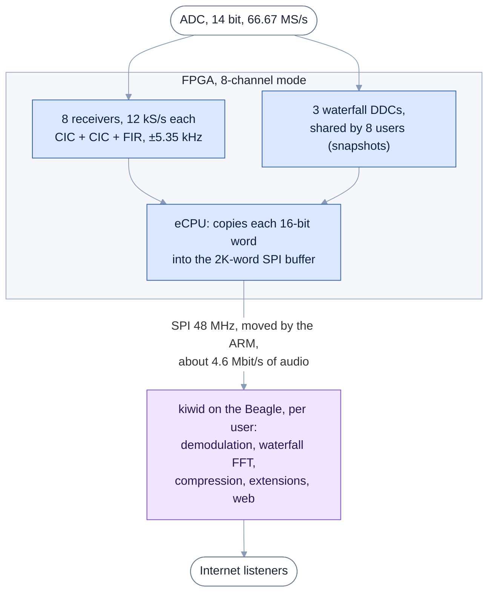
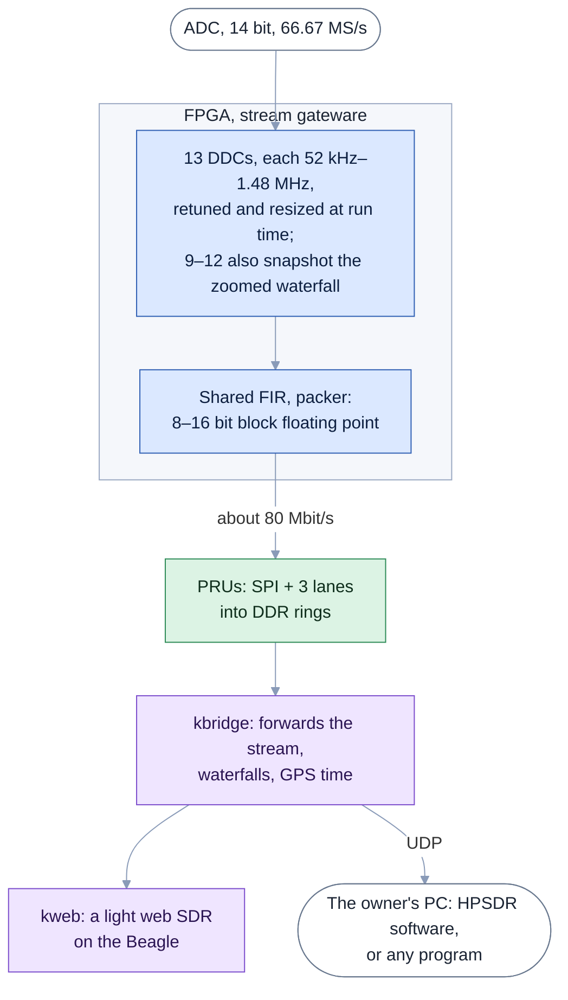
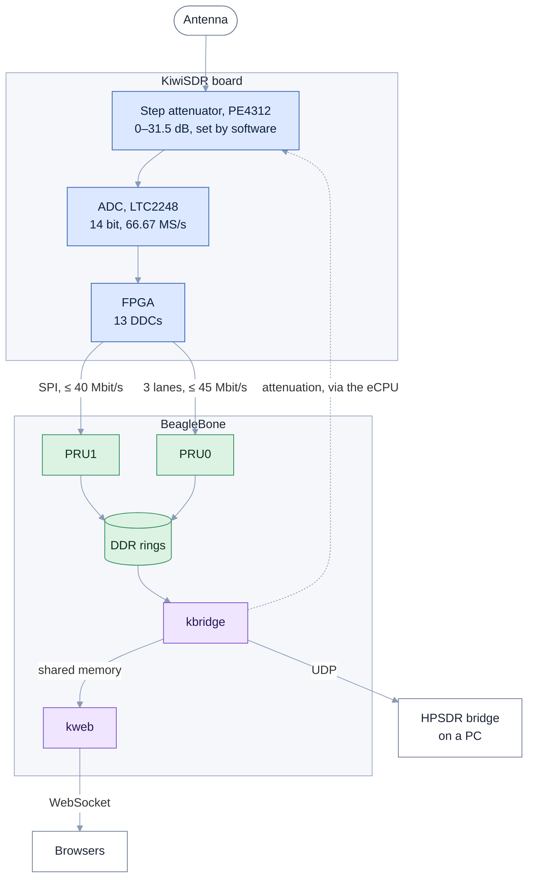

> [!WARNING]
> **Work in progress: not ready for general use.** kiwi-offload is under active development and has been tested on
> one KiwiSDR only. Its interfaces, configuration and behaviour may still change without notice. Until a stable
> release is announced here, please don't install it on a receiver you depend on. If you want to experiment, keep
> the official KiwiSDR software ready to restore (`sudo systemctl enable --now kiwid`).

# kiwi-offload

> **Please read this first.** kiwi-offload is not an update or an add-on for the KiwiSDR software. It replaces the
> whole stack, from the FPGA gateware to the software on the Beagle, with a different architecture. A Kiwi running it
> stops being the KiwiSDR its creator designed: no public listing, no kiwid web interface, no extensions, and none of
> the official support that comes with them. It becomes a wideband receiver for its owner's own use and software.
> The official software stays installed, and `sudo systemctl enable --now kiwid` turns the board back into a KiwiSDR
> at any time. Questions about kiwi-offload belong in this project, not on the KiwiSDR forum.

> **Keep it on your own network.** kiwi-offload is flexible because its capacity is shared, not divided into fixed
> public slots, and that makes it unsuited to being opened to the internet. One listener's wide receiver takes link
> and CPU from everyone else, and kweb admits listeners on what the CPU can take, not on a promised number of
> channels. kbridge's host port (TCP and UDP 9073) has no authentication: it serves the raw stream to one client
> at a time, whoever connects. kweb serves plain HTTP, and its passwords protect only the owner and admin roles. It is
> meant for its operator, on their own network, within the known limits under
> [Bottlenecks](docs/software.md#11-bottlenecks) and [Example configurations](#example-configurations).

Replacement firmware and software for the **KiwiSDR** (1 or 2) that put its whole hardware to work. The FPGA runs new
gateware with up to 13 freely tunable wideband DDCs. The BeagleBone runs a small bridge (`kbridge`) that drains them
at the SPI link's full rate, plus a lightweight multi-user web SDR (`kweb`). Heavier processing can run on a
separate, faster host on the network.

The stock KiwiSDR software (kiwid, its web UI and extensions) is not used. The installer disables it, and it can
be re-enabled at any time.

**Built on the KiwiSDR.** None of this would exist without the people who made the KiwiSDR 1 and 2. John Seamons
(ZL4VO/KF6VO) created the KiwiSDR: its FPGA design, the eCPU and its firmware, and kiwid. He has kept all of it going
for years, across both boards, with many FPGA images, platforms and extensions and a large community of public
receivers. Others' work is in it too: Andrew Holme's GPS receiver, the CIC filters of Alex Shovkoplyas (VE3NEA) and Phil Harman
(VK6APH), and Christoph Mayer's (DL1CH) compensation filters behind the new 8-channel mode. kiwi-offload stands on
all of it:

- **The gateware** is a modified copy of the KiwiSDR's Verilog. Its receiver is replaced, but the eCPU, its SPI host
  interface and the GPS correlators are kept. The eCPU runs its stock code unchanged.
- **The eCPU and the GPS receiver** descend from Andrew Holme's
  [Homemade GPS Receiver](http://www.aholme.co.uk/GPS/Main.htm).
- **kbridge** re-implements kiwid's FPGA and eCPU protocol and ports its GPS engine: acquisition, tracking, decoding,
  the solution and the clock correction. Its LEDs, RF attenuator and board identification follow kiwid's
  conventions.
- **The HPSDR bridge** is UberSDR's, built on Rick Koch's (N1GP) ka9q_hpsdr.
- **Libraries:** civetweb, pffft and libopus, and the GNU PRU toolchain (dinuxbg/gnupru) to build the PRU firmware.

Licences are under [Licence](#licence).

**How much of the hardware goes unused.** The official software is built for an open web SDR, and it uses a small
part of what the board can deliver:

- **Spectrum:** in its 8-channel mode it carries eight 12 kS/s receivers, about 86 kHz of continuous spectrum out of
  the 30 MHz the ADC sees.
- **The link:** it moves about 4.6 Mbit/s of receiver audio over an SPI link that kiwi-offload measures carrying
  38.4 Mbit/s.
- **Idle parts:** the Beagle's two PRUs aren't used, and the header pins that kiwi-offload turns into a second link
  are kept for an antenna switch.

kiwi-offload carries about 80 Mbit/s from 13 receivers of up to 1.48 MHz each. That is not a judgement on the official
design: it does what it was built for very well. [Two designs for one board](#two-designs-for-one-board) explains why
it is built that way and what each approach gives up.

**Why it can use the whole board.** The capacity has always been in the hardware:

- a 14-bit ADC at 66.67 MS/s that sees all of HF;
- an FPGA that can make wide receivers;
- a 48 MHz SPI link and three spare pins to the Beagle;
- two real-time PRU cores beside the Beagle's ARM.

What holds a Beagle-only design back is the ARM. It is a single core that has to demodulate, draw waterfalls and serve
the web, and on the BeagleBone it also moves every SPI word itself, so each extra bit of data costs it time it needs
elsewhere. kiwi-offload takes that cost off the ARM:

- the FPGA makes 13 wide receivers and packs them into 8–16-bit groups;
- the PRUs pull both links, SPI and the three lanes, into DDR, so the ARM only reads memory;
- the heavy processing moves to a PC on the network, which gets the raw I/Q.

That takes the link from a few Mbit/s to about 80 Mbit/s: every amateur band from 2200 m to 10 m at once, from
hardware that has been able to do it for years.

## Two designs for one board

The KiwiSDR's own software and kiwi-offload run on the same hardware, but they are built for different people.

**The official software is built for an open web SDR on the internet.** Anyone can connect, from anywhere, without
an account, and every listener gets the same thing: one audio channel of fixed width and a waterfall of their own.
The Kiwi can therefore promise a fixed number of channels and keep that promise, whatever mix of strangers turns up.
That is a hard and admirable goal, and the design serves it well. **kiwi-offload is built for the owner** who wants the
whole board under their own control: wide receivers placed where they choose, every band at once, and the data
handed to software of their choice on their own network. Neither design is better in general; each gives up things
that the other keeps. What follows compares them with the official software at v1.902 (July 2026), from its source:
`verilog/`, `kiwi.config`, `e_cpu/`, `rx/`, `platform/`.

### How the official software uses the hardware

- **Narrow receivers, made in the FPGA.** Each receiver mixes to baseband and decimates to the audio rate in the FPGA:
  12 kS/s in the 4-, 8- and 14-channel modes (the filter cuts off at ±5.35 kHz), or 20.25 kS/s in the 3-channel
  mode (±8 kHz). Each one has its own CIC chain, plus Christoph Mayer's (DL1CH) CIC-compensating FIR.
- **A waterfall for each user.** In the "Full 8 channel" mode (`RX_CFG = 83`, new in v1.900), 3 waterfall DDCs are
  time-shared between the 8 users. Each takes a block of samples at the user's zoom, the Beagle runs an FFT on it
  with FFTW, and the user gets their own zoomable waterfall, from z0 (0–30 MHz) to z11. The 4-channel mode has 4
  dedicated waterfall DDCs and zooms to z14.
- **Every word passes through the eCPU, then the ARM.** For each buffer the eCPU executes one instruction per 16-bit
  word (`GET_RX_SAMP`), moving the receivers' samples into the SPI host interface's 2K-word buffer: 24-bit I and Q
  in three 16-bit words per complex sample. An interrupt line from the FPGA wakes the Beagle, which reads the buffer
  with the ARM itself. On the BeagleBone Green and Black it does this by programmed I/O, polling McSPI's status
  register for every word (`platform/beaglebone_black/spi_pio.cpp`); on the other boards it goes through the kernel's
  `spidev` driver. In the 8-channel mode this happens about every 7 ms (141 Hz, 85 samples per channel per transfer).
- **Everything else happens on the Beagle,** in one program, `kiwid`, with its own cooperative task scheduler. It
  does per-user demodulation, AGC and noise processing, the waterfall FFTs and compression, the extensions (FT8, WSPR,
  DRM, FAX, NAVTEX, HFDL, CW skimmer, TDoA and more), GPS, and the web server. It is built for NEON (`-mfpu=neon-vfpv3`
  on the BeagleBone), which its fast-convolution filters use (`support/simd.cpp`). It runs on the BeagleBone
  Green and Black, BeagleBone AI and AI-64, BeagleY-AI and Raspberry Pi (`platform/`).

**Why this is right for an open web SDR:**

- **Costs are predictable.** Every connection costs the same: one fixed-rate channel, one waterfall, one share of the
  CPU. The number of public slots is a property of the FPGA image, so the Kiwi can't be overloaded by any combination
  of users, and the public listing can state exactly what is available.
- **It is fair.** Each listener gets an equal slot. No one user can take the whole band away from the others.
- **It suits the internet.** A 12 kS/s channel and a 1024-bin waterfall row are what a remote listener's browser and
  connection can carry. Making the narrow channels in the FPGA keeps the per-user cost on the Beagle small.
- **It is self-contained.** One box does everything, including decoders that many users depend on. No second
  computer is needed, and it does not depend on any one board's PRUs or on a kernel module, so the same software
  runs on all the boards above.
- **The FPGA is spent on listeners.** The logic goes into narrow receivers and waterfall chains, because that is
  what public listeners use. The new 8-channel mode gives up GPS channels (12 → 8, "need more logic cells to fit
  FPGA") to give 8 users a waterfall each.

**What that leaves unused.** Plainly, the official software uses a small part of what the hardware can deliver.
This follows from its goals and from one constraint of the Beagle, not from oversight:

- **Moving data costs the ARM.** On the single-core BeagleBone Green and Black, programmed-I/O SPI keeps the ARM busy
  for the whole of every transfer, so CPU time grows in step with the data moved. At 48 MHz, the 8-channel mode's 4.6 Mbit/s of
  receiver audio already takes about a tenth of the core's time (4.6 / 48), before any waterfall data. Carrying the
  link's full capacity this way would leave almost nothing for demodulation or the web server. For a design that
  does all its processing on the Beagle, moving as little data as possible is the right choice. It is also the main
  reason the rest goes unused:

- **The link.** The SPI link runs at 48 MHz in both designs. In the 8-channel mode the official software moves about
  4.6 Mbit/s of receiver audio (8 × 12 kS/s × 48 bits), plus the waterfall blocks. kiwi-offload measures the same
  link carrying 38.4 Mbit/s.
- **The spectrum.** The ADC sees all of 0–30 MHz. Eight 12 kS/s receivers carry about 86 kHz of it at once (8 ×
  10.7 kHz). The waterfalls see more, but as snapshots, not continuous I/Q.
- **The Beagle's real-time cores and spare pins.** The two PRUs are not used. The P8 header pins that kiwi-offload
  turns into a second link are left as FPGA inputs in the official build, so the Beagle can drive an antenna switch
  on them ("for compatibility with antenna switch extension", `verilog/kiwi.v`). P9_24 is its audio interrupt line.
- **I/Q for other software.** The official software gets data out through each channel's audio and I/Q streams and
  its extensions. In the shipped FPGA images each channel is 12 or 20.25 kS/s. The source also has a wideband
  configuration (`RX_CFG = 1`: one receiver at 72–300 kS/s), but no FPGA image is shipped for it. Nothing takes
  several wide slices to a PC at once.

### How kiwi-offload uses it

**What it gives an owner:**

- **The whole band at once.** 13 wide receivers can cover every amateur band from 2200 m to 10 m at the same time.
  Each is placed, widened and given its bit depth at run time.
- **Data for your own software.** Raw I/Q goes to a PC on your network at up to about 80 Mbit/s: to HPSDR programs
  through `kiwi-hpsdr-bridge`, or to anything that speaks kbridge's protocol. The heavy processing moves to a
  computer that can afford it.
- **The rest of the board, used.** Both PRUs carry the stream, the spare pins become a second link, and the Beagle's
  one core is left almost entirely for kweb and Linux.
- **Decoders run in the browser, by design.** Anything only one listener needs runs on that listener's own
  computer: FT8/FT4/FT2/WSPR decoding (`jt9` and `wsprd` built for WebAssembly) and the notch and noise reduction.
  The Beagle only demodulates the VFO, as for any listener, so decoding costs its one core nothing however many
  listeners decode (a decoding VFO's audio comes as 12 kS/s PCM, about half a percent of the core more than ADPCM).
  See [Decoders and noise reduction run in the browser](docs/software.md#decoders-and-noise-reduction-run-in-the-browser).
- **Listen along.** A listener can hear another listener's VFO and see their waterfall, like camping on a stock
  KiwiSDR's channel. kweb copies the VFO's encoded audio, so it costs about 0.65 % of the Beagle's core per
  follower instead of 3.3 % for a VFO of their own. The "On air" list shows every listener's frequency and mode (as
  "listener N", never an address or a name) and what the PC and the board are doing. See
  [Listen along and "On air"](docs/software.md#listen-along-and-on-air).
- **Precise timing.** Samples carry ADC-tick timestamps tied to GPS. The board serves NTP and a 1 PPS to chrony.
- **A zoomable waterfall for every web user**, from all of 0–33 MHz down to 2 kHz across. Zoomed in, it shows a
  running receiver's own rows where one covers the view, and elsewhere frames from whichever of DDCs 9–12 nobody is
  using at that moment, retuned to each user's view in turn. Each user can turn their waterfall off, or listen to
  the waterfall alone.

**What it gives up**, so that this is clear before anyone switches:

- **Built for an owner, not for an open public service.** One host client is served at a time. kweb admits listeners
  only as the CPU allows; it does not promise a fixed number of slots.
- **A PC for the heavy work.** The Beagle alone does far less with the stream than the PC can.
- **Zoomed detail is shared, and it gives way.** Away from running receivers, one spare DDC serves every zoomed view
  in turn. Ten users zoomed in at once, each somewhere different, measured about 8.5 rows a second each (narrow views
  take the DDC longest), and when listeners or the host hold all of DDCs 9–12 there is no detail until one is free.
  The official software's 8-channel mode also takes turns, on three waterfall DDCs kept for its eight users.
- **None of the official extensions.** kweb decodes FT8/FT4/FT2/WSPR in the browser; the rest are not available.
- **Fewer GPS channels:** 4 rather than 8–12 (see [Why 4 GPS channels are enough](docs/hardware.md#1-the-fpga)).
- **One platform:** a KiwiSDR 1 or 2 with an XC7A35T, on a BeagleBone Green or Black, with the PRUs and a kernel
  module.
- **No antenna switch.** kiwid's antenna switch (`pkgs/ant_switch`) is part of kiwid, which isn't running. Its
  network backends (KMTronic, the MS-S series, Snaptekk, an Arduino on a network shield) could still be driven by
  your own software, but kiwi-offload doesn't drive them. Its Beagle GPIO backend can't work at all. That backend
  drives antennas 1–10 from the Beagle on P8_11–P8_19 and P8_26, which is why the official build leaves those pins
  as FPGA inputs. The stream build needs them for itself:
  - P8_11 and P8_12 carry PRU0's lane clock and request;
  - P8_15 and P8_16 carry two of the lanes, driven by the FPGA;
  - the FPGA drives the other six from an unused control bit.

  Two outputs on one wire is no way to treat a Beagle. Until someone moves the lanes, the antennas get switched by
  hand.

**What it kept from home.** Some of kiwid's small comforts made the move:

- **The four LEDs** on the Beagle still say what is going on: stream, GPS, host client, web listener. They use
  kiwid's own brightness settings, from brightest down to dimmest, the dimmer ones by the same crude 1 ms PWM. They
  don't do the Cylon sweep or flash the IP address digit by digit, so finding the Kiwi on the network is a job for
  your router.
- **A failed FPGA load** shows kiwid's own error code in binary on the LEDs, so the familiar troubleshooting codes
  still mean the same thing.
- **The RF step attenuator** is driven the same way kiwid drives it, and is assumed fitted by the same rule: a
  KiwiSDR 2 with a serial number from 20000 to 22999.
- **The board's identity**: kbridge reads the cape EEPROM's model and serial number and the FPGA's DNA, and counts
  ADC overloads, as kiwid does.
- **GPS** still keeps time, with four channels instead of eight to twelve, and it has learned to serve NTP and a
  1 PPS.

The official software stays installed. `sudo systemctl enable --now kiwid` brings it back, so an owner can choose
between the two designs at any time.

## What you get

- **Stream gateware** (`gateware/`, prebuilt in `firmware/`): 13 independent DDCs, each tunable anywhere in
  0–30 MHz with its own rate (65 kS/s … 1.85 MS/s), with a shared CIC-compensating FIR and block-floating-point
  packing (8–16 bit mantissas). It also sends raw-ADC snapshots for a full-band 0–33 MHz waterfall, lets DDCs 9–12
  double as snapshot receivers for the zoomed waterfall while they aren't streaming, has a GPS front end and generates
  a GPS 1 PPS output. Data leaves the FPGA over two links at once: SPI, driven by a PRU, and three
  spare pins sampled by the second PRU. Together they carry about 80 Mbit/s (measured: 38.4 + 41.6; the allocator's
  budgets are 40 + 45), enough for every amateur band from 2200 m to 10 m simultaneously.
- **kbridge** (`bridge/`, runs on the Beagle): loads the FPGA, drives both links through DMA rings (`kmod/kodma`),
  computes the full-band waterfall and the zoomed waterfall's DDC snapshots, does GPS (time, position, ADC clock calibration, chrony and PPS), and serves
  the I/Q stream to one host client over TCP (control) and UDP (data). It also shares DDCs with kweb through shared
  memory.
- **kweb** (`kweb/`, runs on the Beagle): a multi-user web SDR on port 8073. Each user has a waterfall that zooms
  from the full band to 2 kHz across (or can turn it off, or listen to it alone), several VFOs, AM/SAM/SSB/CW/FM modes, ADPCM/PCM/Opus audio, in-browser
  FT8/FT4/FT2/WSPR decoding, a GPS panel and an admin page (`/admin.html`).
- **kiwi-hpsdr-bridge** (`host/hpsdr/`, runs on a PC): makes the Kiwi look like an openHPSDR radio (Hermes /
  Hermes Lite 2) to Thetis, SparkSDR, piHPSDR and other HPSDR software, with up to 10 receivers (openHPSDR protocol 2;
  protocol 1 offers one). See its
  [README](host/hpsdr/README.md).

## How it works

The signal goes from the antenna to the network in five stages. The analog front end is simplified here: only the
parts the software controls or reads are shown, and only the data path: control, time and the 1 PPS have diagrams
of their own in the two parts below.

The details are in two parts:

**[How it works: the FPGA and the Beagle](docs/hardware.md)**

- [1. The FPGA](docs/hardware.md#1-the-fpga)
- [2. Into the BeagleBone](docs/hardware.md#2-into-the-beaglebone)
- [3. The kernel module (kodma)](docs/hardware.md#3-the-kernel-module-kodma)

**[How it works: the software](docs/software.md)**

- [4. The ARM: kbridge](docs/software.md#4-the-arm-kbridge)
- [5. The full-band spectrum](docs/software.md#5-the-full-band-spectrum), and
  [the zoomable waterfall's DDC snapshots](docs/software.md#the-zoomable-waterfall-ddc-snapshots)
- [6. GPS, the ADC clock and time](docs/software.md#6-gps-the-adc-clock-and-time)
- [7. The ARM: kweb](docs/software.md#7-the-arm-kweb)
- [8. Ethernet](docs/software.md#8-ethernet)
- [9. The HPSDR bridge (on a PC)](docs/software.md#9-the-hpsdr-bridge-on-a-pc)
- [10. NEON SIMD](docs/software.md#10-neon-simd)
- [11. Bottlenecks](docs/software.md#11-bottlenecks)

## Hardware

- **A KiwiSDR 1 or 2** with an Artix-7 XC7A35T, on a BeagleBone Green or Black. Both boards are built around the same
  core: the XC7A35T, an LTC2248 14-bit ADC at 66.67 MHz, a MAX2769 GPS front end and the same Beagle cape header. The
  official software ships one set of FPGA images for both, and kiwi-offload treats them the same way. kiwi-offload
  was developed and tested on a KiwiSDR 2.
- **What differs between the two** is handled as kiwid handles it:
  - **The model** is read from the cape EEPROM; kbridge recognises both (`bridge/khw.c`).
  - **The PE4312 RF step attenuator** exists only on KiwiSDR 2 boards. It is assumed fitted on serial numbers 20000 to
    22999, as kiwid decides; `rf_attn_fitted` overrides. A KiwiSDR 1 gets no attenuator writes.
  - **The GPS TCXO start-up workaround:** the gateware starts `cpu_clk` on ADC_CLKIN / 4 and switches to the TCXO once
    the MAX2769 is programmed. It was added for the KiwiSDR 2 and is harmless on a KiwiSDR 1.
- **Not supported: boards with an XC7A50T.** The official software ships separate `KiwiSDR_a50.*` images for them, and
  the prebuilt image here is for the XC7A35T only. A rebuild for the A50 would need the part changed
  (`tools/vivado_build.sh … xc7a50tftg256-1`) and has not been tried.
- **Debian 11 on the Beagle** (kernel 5.10-ti), the system kiwi-offload was developed and tested on.

## Installing on the Beagle

Build a release on a Linux PC (see [Building](#building)):

    ./build.sh beagle     # -> build/kiwi-offload-<version>.tar.gz

Copy it to the Kiwi, unpack it and run the installer as root:

    tar xzf kiwi-offload-<version>.tar.gz
    sudo ./kiwi-offload-<version>/tools/install.sh --dry-run     # show what it would do
    sudo ./kiwi-offload-<version>/tools/install.sh               # options: --dir (default /home/debian/ko), --user (debian), --no-start

What `tools/install.sh` does:

- **Stock software:** disables kiwid without removing it. `sudo systemctl enable --now kiwid` brings it back; the
  two conflict, so starting one stops the other.
- **Packages:** installs chrony (replacing systemd-timesyncd) and the kernel headers.
- **Files:** puts the binaries, web page, FPGA image and eCPU code in `/home/debian/ko`, and the PRU firmware in
  `/lib/firmware`.
- **Kernel module:** builds `kodma` on the Beagle for its running kernel and loads it at boot (see
  [The kernel module](#the-kernel-module)).
- **Time:** adds the chrony configuration. kbridge supplies GPS time, and NTP is served to the RFC 1918 ranges
  only; put `allow` lines for other networks in a site file such as `/etc/chrony/conf.d/local.conf`.
- **Watchdog:** turns on the hardware watchdog.
- **Services:** enables and starts `kiwi-offload.target`, which runs kbridge (as root) and kweb (as `debian`).
  systemd restarts either one if it fails.

It is safe to run again: only changed files are replaced, and an existing `/home/debian/ko/kiwi-offload.conf` is
never touched. **Re-run it after a kernel update**, because kodma has to be rebuilt for the new kernel.

Afterwards:

- Web SDR: `http://<kiwi>:8073/`
- Service status: `systemctl status kiwi-offload.target kiwi-offload-kbridge kiwi-offload-kweb`
- Logs: `/run/kiwi-offload/kwb.log` and `/run/kiwi-offload/kweb.log`
- GPS time: `chronyc sources`

## Configuration

Everything is in one file, `/home/debian/ko/kiwi-offload.conf`, created from
[`config/kiwi-offload.conf.example`](config/kiwi-offload.conf.example), which documents every key:

| Section | What it sets |
|---|---|
| `[kbridge]` | FPGA image, links, GPS |
| `[host]` | the host's standing slices |
| `[pool]` | how many DDCs the host and the web SDR may use |
| `[kweb]` | users, VFOs, passwords, the waterfall, defaults |
| `[window …]` | the web SDR's band windows |

`tools/kiwi-offload.sh start|stop|restart|status` controls the services. The admin page, enabled by setting
`admin_password` in `[kweb]`, can also edit the file.

### How the host and the web SDR share the board

- **`[host] slices`** are the host's standing receivers: `<kHz>:<R>[:<gain>][:L][:b<bits>]`. Here R sets the rate
  (66.6666 MHz / 2R), `:L` puts the slice on the lanes (otherwise SPI) and `:b` sets the bit depth (default 12).
  kbridge puts slices with R > 256 on DDCs 0–3 and the rest in ascending R, so the shared FIR keeps up. They are
  programmed when a host client connects and deleted when it leaves. A host program can also ask for slices of its
  own at run time; the HPSDR bridge does, and clears the standing ones first.
- **`[pool] host_ddcs` and `web_ddcs`** cap how many DDCs each side may hold.
  - If the two add up to 13 or less, it is a fixed split: each side always has its own DDCs.
  - If they add up to more, they overlap, and the host takes DDCs back from the web SDR when it needs them.

  Either way, a host request refused for link or FIR budget also takes back kweb's DDCs and is tried again. The host
  always comes first.
- **kweb** starts a band window or an own receiver only when a listener picks one, and only if the DDC, the link,
  the FIR and its CPU guard all have room. Wherever a host slice already covers the band, it uses that instead, at no
  cost to the link.
- **The zoomed waterfall** holds no DDC. Between frames, kbridge borrows the highest of DDCs 9–12 that no slice is
  using; a listener or the host that needs it takes it at once, and the snapshots move to the next free one. Their
  frames use what SPI has left, outside the link budget, at the lowest priority.

### Example configurations

Practical set-ups drawn as diagrams for anyone, with what each leaves for web listeners and what runs out first, are in
**[docs/use-cases.html](docs/use-cases.html)** (download it or open it through a raw-HTML viewer: GitHub shows HTML as source).

Six configurations, each checked against kbridge's rules and drawn with what it uses, are in
**[Example configurations](docs/examples.md)**:

1. Every amateur band to a PC, at once
2. Ten HPSDR receivers at 192 kHz, with web users to spare
3. The widest slices: two of 1.48 MHz
4. A fixed split: FT8 on ten bands for a decoder, three DDCs for the web
5. A web SDR only
6. Skim every band, and share the listening

## Building

On a Linux PC (x86-64 or arm64), install the compilers once (Debian/Ubuntu):

    sudo apt install build-essential curl xz-utils gcc-arm-linux-gnueabihf g++-arm-linux-gnueabihf

then, from the repository root:

    ./build.sh            # the Beagle release and the HPSDR bridge for this PC
    ./build.sh beagle     # only the Beagle release: build/kiwi-offload-<version>.tar.gz
    ./build.sh hpsdr      # only the HPSDR bridge: build/host/kiwi-hpsdr-bridge_<arch> (and its test client)
    ./build.sh test       # host-side tests (GPS maths, kweb DSP, HPSDR framing)

On first use `build.sh` downloads the GNU PRU toolchain (no distribution packages it) from
[github.com/dinuxbg/gnupru](https://github.com/dinuxbg/gnupru) into `vendor/gnupru/`, checksum verified. The
individual make targets it runs:

| Target | Needs | Builds |
|---|---|---|
| `make bridge` | `gcc-arm-linux-gnueabihf` | `build/arm/kbridge` (static ARMv7) |
| `make -C kweb` | `g++-arm-linux-gnueabihf`, `curl` (fetches and cross-builds libopus 1.4 the first time) | `build/arm/kweb/kweb` |
| `make pru` | the GNU PRU toolchain in `vendor/gnupru/` (`build.sh` fetches it) | `build/pru/*.elf` |
| `make wasm` | `curl` | the FT8/FT4/FT2/WSPR WebAssembly decoders for the web page, from [ubersdr_wsprd](https://github.com/madpsy/ubersdr_wsprd)'s releases |
| `make dist` | all of the above | the release tarball |
| `make -C host/hpsdr` | `gcc` | the HPSDR bridge for this machine (`host/hpsdr/build/`) |
| `make` | `g++` | the eCPU assembler and eCPU code (`build/gen/`) |

You can override the cross-compiler prefix with `CROSS=` and the PRU compiler with `PRU_CC=` (for `build.sh` too).

### The FPGA image

You don't need to build it: the image is prebuilt in `firmware/` and every release includes it. Rebuilding it needs
Vivado 2024.2 (a large install; the free edition covers the XC7A35T): `tools/vivado_build.sh gateware stream <name>`
builds into `build/vivado/<name>/` in about 15 minutes. A rebuild of this repository matches
`firmware/stream_v25_13_lanes.bit` except for the build date in the header. The testbenches in
`gateware/stream/tb_*.v` run with Icarus Verilog (`iverilog -g2012`).

### The kernel module

`kodma` (`kmod/`) gives the PRUs DMA-able rings in DDR. A kernel module must be built against the exact kernel it
runs on, so it is not part of the release as a binary: the release carries its source, and `tools/install.sh`
builds it on the Beagle. It installs `linux-headers-$(uname -r)` from the Beagle's package sources, builds the
module with the Beagle's own gcc (a few seconds), installs it as `/lib/modules/<kernel>/extra/kodma.ko` and
loads it at boot. After a kernel update, run `tools/install.sh` again and it rebuilds the module. By hand, on the
Beagle:

    sudo apt install linux-headers-$(uname -r)
    make -C /home/debian/ko/kmod
    sudo insmod /home/debian/ko/kmod/kodma.ko

Cross-building it on a PC is possible (`make -C kmod KDIR=<that kernel's build tree> ARCH=arm
CROSS_COMPILE=arm-linux-gnueabihf-`) but needs the configured source tree of the Beagle's exact kernel, so
building on the Beagle is simpler.

## Layout

| Path | Contents |
|---|---|
| `docs/` | how it works in detail ([the FPGA and the Beagle](docs/hardware.md), [the software](docs/software.md)) and [example configurations](docs/examples.md) |
| `bridge/` | kbridge: FPGA loader, SPI/PRU drain, the full-band waterfall and DDC snapshots, GPS, shared-memory interface (`kshm.h`) |
| `kweb/` | the web SDR: C++17 server (`src/`), web page (`www/`), host-side tests (`test/`) |
| `pru/` | PRU firmware: SPI master (`kpru.c`) and lanes receiver (`klanes.c`) |
| `kmod/` | `kodma`: kernel module providing DMA-able DDR rings for the PRUs |
| `gateware/` | the stream FPGA design: KiwiSDR's Verilog plus the new DDC/FIR/packing/link modules in `stream/` |
| `firmware/` | the prebuilt FPGA image ([details](firmware/README.md)) |
| `host/hpsdr/` | kiwi-hpsdr-bridge, the openHPSDR emulator for a PC |
| `config/` | the example configuration, systemd units, chrony/journald/watchdog snippets, the PPS device-tree overlay |
| `build.sh` | builds the release, the HPSDR bridge and runs the tests (see [Building](#building)) |
| `tools/` | installer, service script, Vivado build scripts, Opus build, test programs |
| `upstream/` | files copied unchanged from [KiwiSDR](https://github.com/jks-prv/KiwiSDR) (`develop` branch at `2b92ec6`): the stock Verilog (for reference; `gateware/` is the modified copy), and the eCPU firmware source and assembler. The eCPU code in use is the stock `upstream/bitstreams/KiwiSDR.rx8.wf3.aout`, built from `upstream/e_cpu/`. |
| `third_party/` | [civetweb](https://github.com/civetweb/civetweb) (HTTP/WebSocket) and [pffft](https://bitbucket.org/jpommier/pffft) (FFT) |

## Hard limits of the hardware

See [Bottlenecks](docs/software.md#11-bottlenecks): the ADC's 933 Mbit/s can't leave the board raw; the two links carry 40 + 45 Mbit/s
(87 Mbit/s in total), split across DDCs however you like; the Beagle has one CPU core and 100 Mbit/s Ethernet; the
gateware fills 98.9 % of the XC7A35T's LUTs.

## Licence

GPL v3, see [LICENSE](LICENSE). Files under `upstream/` and the gateware derived from them are KiwiSDR's (John
Seamons and contributors; the Verilog is GPL v3 or later, see `upstream/_LICENSE`, `upstream/_COPYRIGHT` and each
file's header). `host/hpsdr/` is GPL v3 (its own
`LICENSE`). `third_party/` keeps its own licences (civetweb: MIT; pffft: FFTPACK, BSD-like). libopus (BSD) and the GNU PRU toolchain
are fetched at build time under their own licences.
