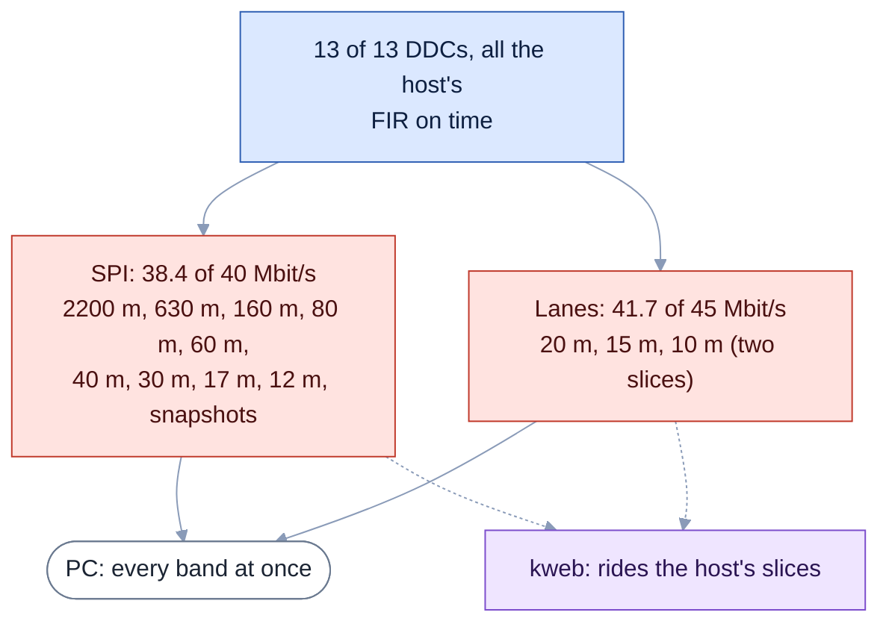
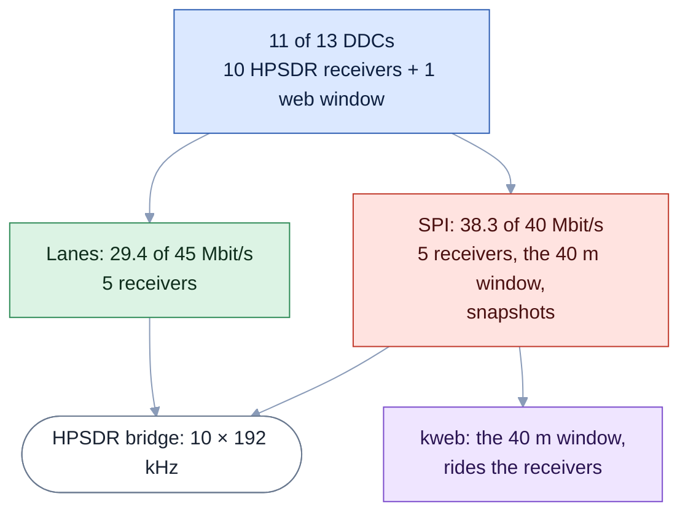
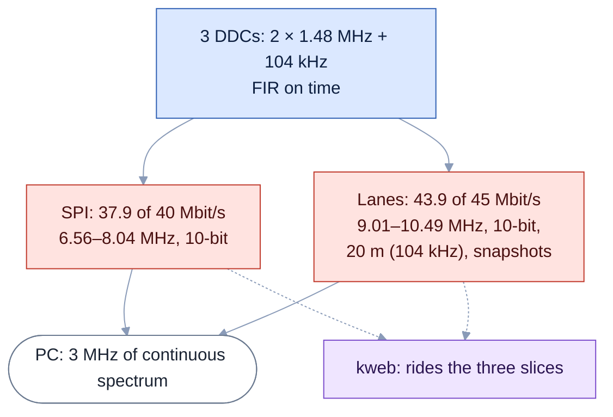
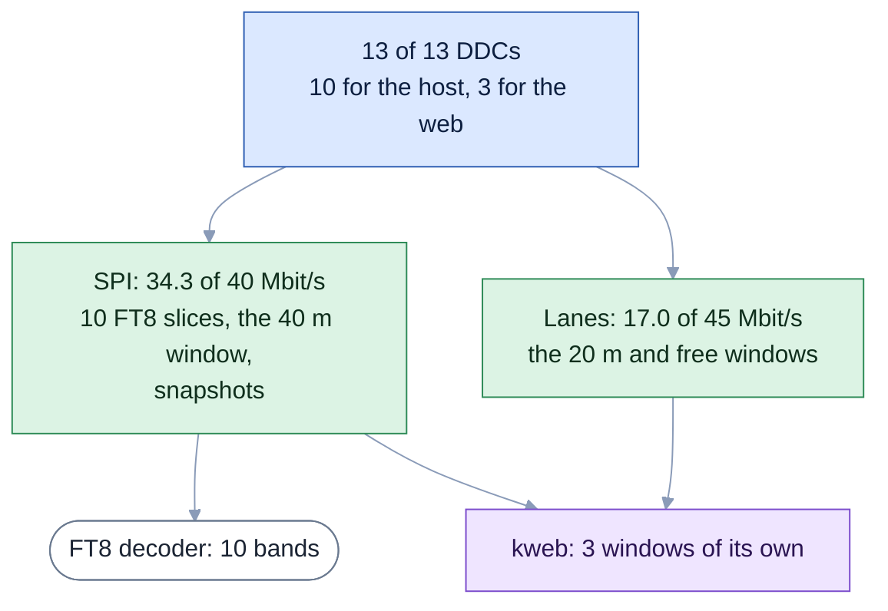
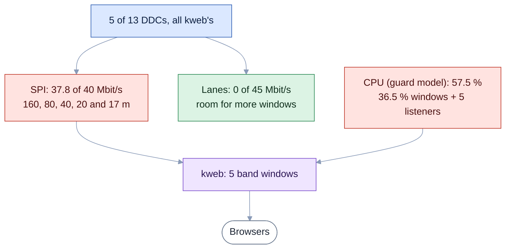
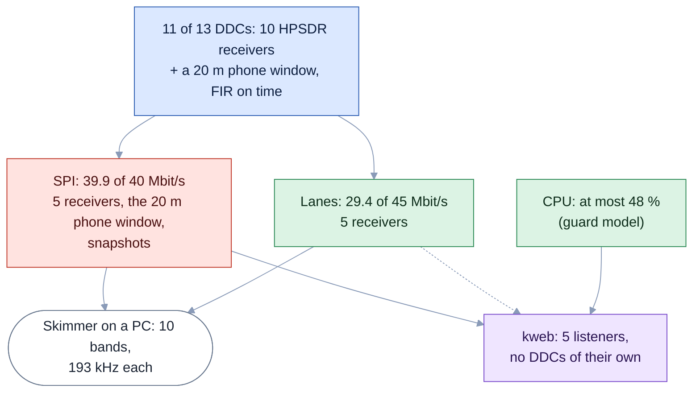

# Example configurations

The same kind of set-ups, drawn for people who don't know the board, with what each leaves for web listeners, are in
[use-cases.html](use-cases.html).

[README](../README.md) · [the FPGA and the Beagle](hardware.md) · [the software](software.md) · [example configurations](examples.md)

Each of these was checked against kbridge's own rules: the DDC count, R > 256 only on DDCs 0–3, the shared FIR's
schedule (`fir_sched_ok`), the link budgets (SPI 40, lanes 45, 87 Mbit/s in all, with the waterfall's 2.8 Mbit/s of
snapshots included), and kweb's CPU guard model where it applies. The figures are what the allocator computes. In the
diagrams, red marks what limits the example: a link that is nearly full, or the CPU.

Each example also says what is left for the zoomed waterfall's detail away from running receivers, the DDC snapshots
([how they work](software.md#the-zoomable-waterfall-ddc-snapshots)). They need one of DDCs 9–12 free and the raw
snapshots on SPI, and they are not in the link budget: up to 100 frames/s in all, or 20 while the slices on SPI take
more than 33 Mbit/s of its budget.

**1. Every amateur band to a PC, at once.** This is `config/kiwi-offload.conf.example` as shipped: 13 slices, from
2200 m to 10 m, with 10 m covered from 28.0 to 28.5 and 28.54 to 28.86 MHz in two slices. It is as full as the board
gets.



```ini
[host]
slices = 136.75:511:4:b10 475.5:511:4:b10 10125:400:4 1905:140:4 3650:87:4 5332:180:4:b10 7100:133:4
slices = 18118:256:4 24940:256:4:b10 14175:76:4:L:b10 21225:59:4:L:b10 28250:53:4:L:b10 28700:83:4:L:b10
[pool]
host_ddcs = 13
web_ddcs = 13
```

| DDCs | SPI | lanes | total | FIR |
|---|---|---|---|---|
| 13 of 13 | 38.4 of 40 Mbit/s | 41.7 of 45 | 80.0 of 87 | on time |

While the host is connected it holds every DDC, and kweb's listeners ride the host's slices, which cover every shipped
band window except `10m upper` (28.5–29.0 MHz). With every DDC streaming there are no DDC snapshots: zoomed in, the
waterfall shows the slices' own rows where a listener has one open, and the full band elsewhere. When the host leaves,
kweb can use all 13 for its own windows.

**2. Ten HPSDR receivers at 192 kHz, with web users to spare.** `kiwi-hpsdr-bridge` with 10 receivers at 192 kHz
(R 138), the most HPSDR software asks for, and kweb serving listeners beside it. The diagram shows one of the
variants in the table below:



```ini
[pool]
host_ddcs = 10
web_ddcs = 3
```

kbridge spreads the receivers over both links, five each. While the host is on the lanes, kweb's own DDCs use SPI
only, so SPI's 40 Mbit/s is the web SDR's budget. The bridge's `--bits` option trades the receivers' bit depth for
room on it: each receiver costs 5.9 Mbit/s at 12 bits, 4.9 at 10 and 4.0 at 8. All of these were checked:

| HPSDR `--bits` | kweb's own DDCs | DDCs | SPI (of 40) | lanes (of 45) | total (of 87) |
|---|---|---|---|---|---|
| 12 | none: listeners ride the 10 receivers | 10 | 32.2 | 29.4 | 61.7 |
| 12 | one 200 kHz window (40 m) | 11 | 38.3 | 29.4 | 67.8 |
| 12 | one 250 kHz window (20 m phone) | 11 | 39.9 | 29.4 | 69.4 |
| 12 | two 104 kHz own receivers | 12 | 38.6 | 29.4 | 68.0 |
| 10 | a 250 kHz window and a 104 kHz receiver | 12 | 38.4 | 24.7 | 63.1 |
| 10 | a 200 kHz window and two 104 kHz receivers | 13 | 39.99 | 24.7 | 64.7 |
| 8 | 250 and 200 kHz windows and a 104 kHz receiver | 13 | 39.7 | 19.9 | 59.6 |

The FIR keeps up in every row. Listeners on the ten receivers cost no link at all, only CPU (see example 6). The
receivers take DDCs 0–9, so the zoomed waterfall's DDC snapshots use DDC 12 while kweb leaves it free: at up to 100
frames/s with no kweb DDC (SPI 32.2), at 20 frames/s with any of the windows or receivers above (SPI over 33), and not
at all in the last two rows, where all 13 DDCs stream. Own
receivers are 104 kHz here: the 52 kHz size needs one of DDCs 0–3, and the receivers already hold those. The
extremes:

- **Six receivers at 384 kHz** (R 69) fill the links: SPI 38.1, lanes 35.3. A seventh would need 47.1 on the lanes.
- **48 and 96 kHz receivers need R > 256** (R 511 and 277), which only DDCs 0–3 can do. The bridge puts the first four
  there and gives the rest a 104 kHz slice (R 256) instead. Ten receivers at 48 kHz then cost 25 Mbit/s, and at
  96 kHz 31 Mbit/s.

**3. The widest slices: two of 1.48 MHz.** At R = 18, each slice is 1.85 MS/s. That is possible only at 10 bits or
less (37.9 Mbit/s; 12 bits would be 45.1), and with one slice on each link. The waterfall's snapshots move to the
lanes to make room on SPI:



```ini
[kbridge]
snapshots = 100:L
[host]
slices = 7300:18:4:b10 9750:18:4:L:b10 14175:256:4:L
```

| DDCs | SPI | lanes | total | FIR |
|---|---|---|---|---|
| 3 | 37.9 of 40 | 43.9 of 45 | 81.8 of 87 | on time |

That covers 6.56–8.04 MHz and 9.01–10.49 MHz continuously, plus 104 kHz of 20 m. Little else fits. A fourth slice
of 104 kHz or wider takes either link past its budget. A 52 kHz one (R 511, 1.6 Mbit/s at 12 bits) still fits on SPI
when it is asked for at run time: it goes on DDC 3, after the others, and the FIR keeps up. Listed in `[host] slices`
it would not: kbridge programs narrow slices first, on DDC 0, and the 1.48 MHz slices behind it would be late for the
FIR. kweb's listeners ride the three slices. The price of moving the snapshots: kbridge computes the full-band
waterfall only from snapshots on SPI, so in this configuration kweb has no full-band waterfall and no DDC snapshots
either. The slices' own waterfall rows still work.

**4. A fixed split: FT8 on ten bands for a decoder, three DDCs for the web.** Four narrow slices at 52 kHz on
DDCs 0–3, six of 104 kHz:



```ini
[host]
slices = 1840:511:4 3573:511:4 5357:511:4 10136:511:4 7074:256:4 14074:256:4
slices = 18100:256:4 21074:256:4 24915:256:4 28074:256:4
[pool]
host_ddcs = 10
web_ddcs = 3
```

| | DDCs | SPI | lanes | total |
|---|---|---|---|---|
| 10 FT8 slices | 10 | 28.2 | 0 | 28.2 |
| + kweb: 40 m, 20 m and the free window | 13 | 34.3 of 40 | 17.0 of 45 | 51.4 of 87 |

The host's slices use under a third of the link (25.4 Mbit/s; the rest of the 28.2 is the snapshots), so kweb's three DDCs always have room, and the host never needs to
take them back. The order kweb opens them in matters for the FIR: 20 m (R 76, the fastest) is refused if it is
opened last, after both of the others. With the host's slices alone the DDC snapshots use DDC 12 at up to 100 frames/s; once a window is open
they are held to 20 (SPI over 33 Mbit/s), and with all three open no DDC is free for them.

**5. A web SDR only.** No host, and every DDC for kweb:



```ini
[pool]
host_ddcs = 0
web_ddcs = 13
```

Here the limit is the Beagle's CPU, not the link. All eleven shipped band windows need 88.6 Mbit/s, more than the 87
in all, but ten of them fit: every one except `10m upper`, at 73.3 Mbit/s (SPI 38.3, lanes 35.0), FIR on time. The
order kweb opens them in decides whether they do: the two 52 kHz windows (30 m and 60 m) first, while DDCs 0–3 are
free, then the widest first (10, 15, 20, 80, 40, 160, 17, 12 m). Opened narrowest first, the 10 m window comes last
and the FIR refuses it, leaving nine; in band order, or fastest first, only eight run. The CPU guard's model puts those
ten windows at 73.5 % of the CPU before any listener, so the CPU runs out first anyway. Five busy windows, for example
160, 80, 40, 20 and 17 m with one listener each, come to about 57.5 % (36.5 % for the windows, 4.2 % per listener in
USB with ADPCM audio). The guard measures the real idle time, so the actual number depends on what the listeners do.
The narrowest windows (60 m and 30 m, 52 kHz) also need one of DDCs 0–3, so no more than four such windows can run at
once. The zoomed waterfall's DDC snapshots use DDC 12: at up to 100 frames/s with one window open, at 20 while the
windows on SPI take more than 33 Mbit/s (the five above take 37.8).

**6. Skim every band, and share the listening.** This is for an operator who wants a skimmer on every HF band (CW
Skimmer Server, SparkSDR or anything else that speaks HPSDR), feeding the Reverse Beacon Network or PSKreporter, and
also wants a club or friends to listen. Following [Keep it on your own network](../README.md#kiwi-offload), "share" here means on
your network or over a VPN, not an open public web SDR. Within that, the capacity can be made as predictable as a
fixed-slot receiver.



```ini
[pool]
host_ddcs = 10
web_ddcs = 1                ; one DDC for the web: the 20 m phone window below

[kweb]
password = …                ; the owner's: listeners never control a DDC
own_max = 0                 ; no "my own receiver"
free_window = off
max_users = 5
vfo_per_user = 1
show_host_slices = on       ; list the skimmer's receivers as listening ranges
default_source = 20m phone

[window 20m phone]
centre = 14225
width = 250
```

The skimmer tunes its ten receivers, for example to the CW and digital segments of 160, 80, 60, 40, 30, 20, 17, 15,
12 and 10 m (1905, 3595, 5354, 7095, 10125, 14095, 18118, 21095, 24940 and 28095 kHz). Listeners hear any of them, and
the 20 m phone segment through the one web DDC:

| | DDCs | SPI | lanes | total |
|---|---|---|---|---|
| 10 skimmer receivers at 192 kHz | 10 | 32.2 | 29.4 | 61.7 |
| + the 20 m phone window (250 kHz, R 106) | 11 | 39.9 of 40 | 29.4 of 45 | 69.4 of 87 |

The phone window takes SPI to within 0.1 Mbit/s of its budget, and it is the one DDC the web may hold
(`web_ddcs = 1`), so a second window is refused by kweb ("no DDC is free for web listeners"). DDC 12 stays free for
the zoomed waterfall's DDC snapshots, at 20 frames/s (SPI over 33 Mbit/s).

**Why the listening is predictable.** Listeners can't create DDCs (`own_max = 0`, no free window), so they only ride
sources that already exist. Each listener costs the CPU guard about 4.2 % (1.0 for the user and 3.2 for an SSB VFO
with ADPCM audio; Opus adds 2.3 %). Each receiver that at least one listener uses costs about 6.3 % on SPI or 6.5 % on
the lanes, and kweb opens at most three at once (`max_sources = 3`, the default): further listeners share them. The
20 m phone window, which doesn't count towards that, costs 7.9 % while anyone is on it. With `max_users = 5` and one
VFO each, the worst case is five listeners spread over three receivers and the phone window: about 48 %. Five on the
same receiver cost about 27.5 %.

| listeners | all on one receiver | spread over three receivers |
|---|---|---|
| 3 | 19 % | 32 % |
| 5 | 27.5 % | 40.5 % |
| 8 | 40 % | 53 % |

Add 7.9 % while the phone window is open as well. Costlier modes cost more: five listeners in SAM stereo with Opus HQ
reach about 76 %. These are the guard's model figures. The guard itself measures the real idle time, which includes kbridge's own work
moving 69 Mbit/s, and refuses a listener who doesn't fit with a note saying why. Set `max_users` from what the admin
page shows on your board: that number of listeners is then always served.

Two more things to know:

- **Listeners follow the skimmer.** A listener on a skimmer receiver hears wherever the skimmer has it tuned. If it
  moves away, kweb moves them to a source that still covers their frequency, or gives the band its own DDC if one is
  free.
- **Other band windows** in the configuration can stay. When one can't get a DDC, its listeners are moved to a
  receiver that covers at least 20 kHz of it.
