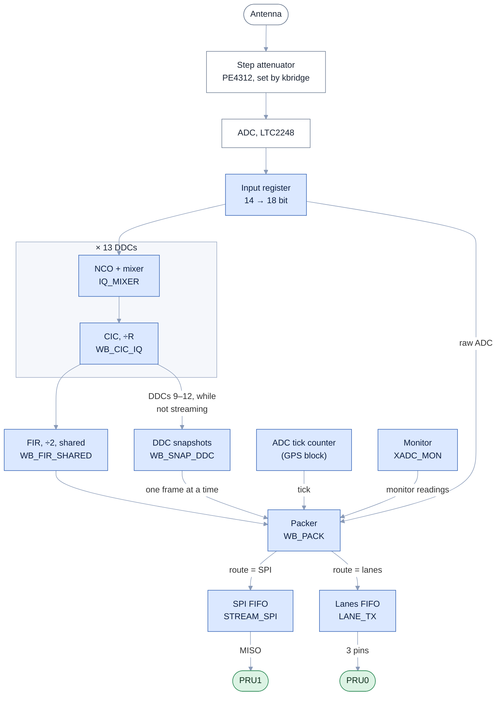
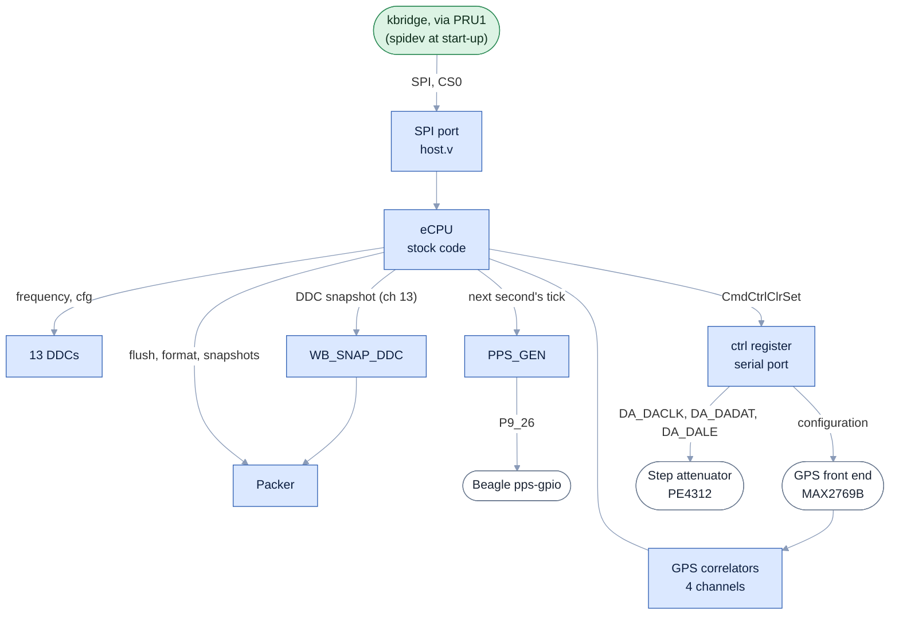
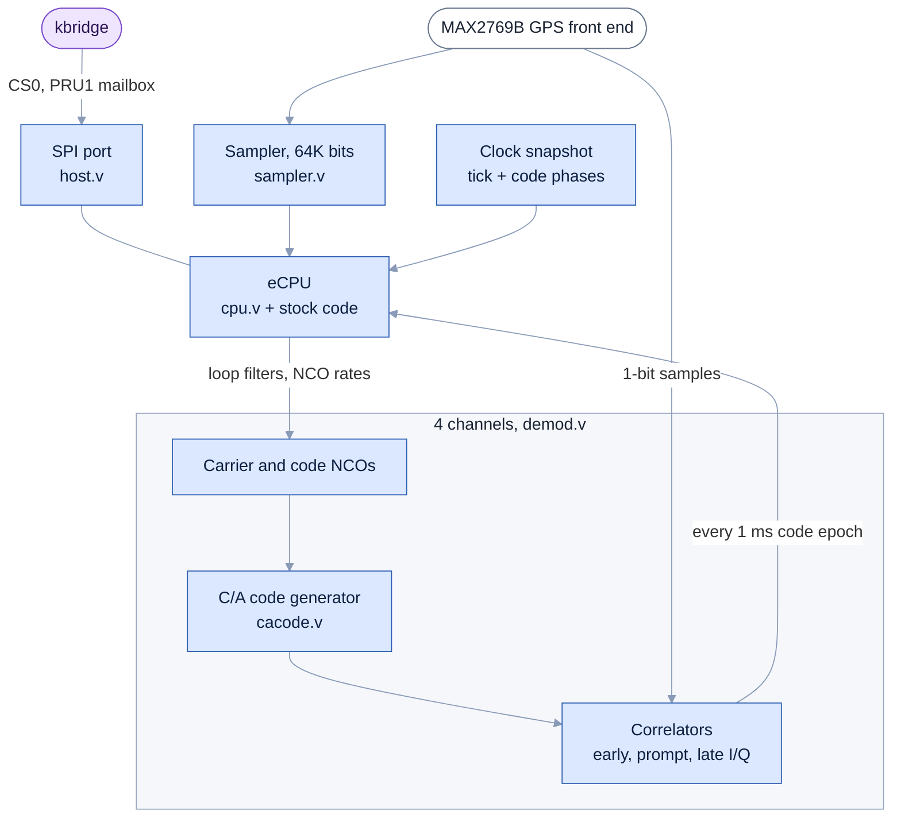
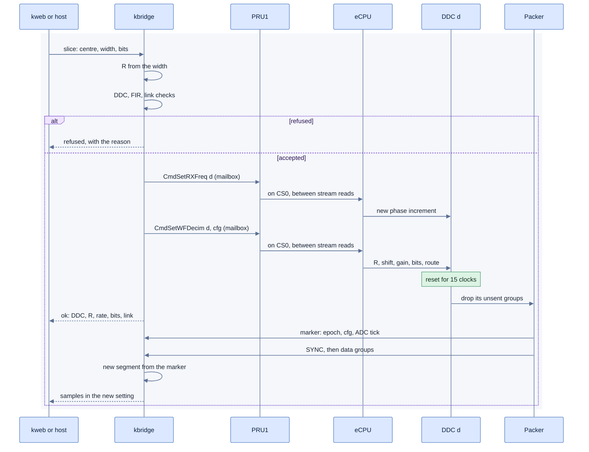
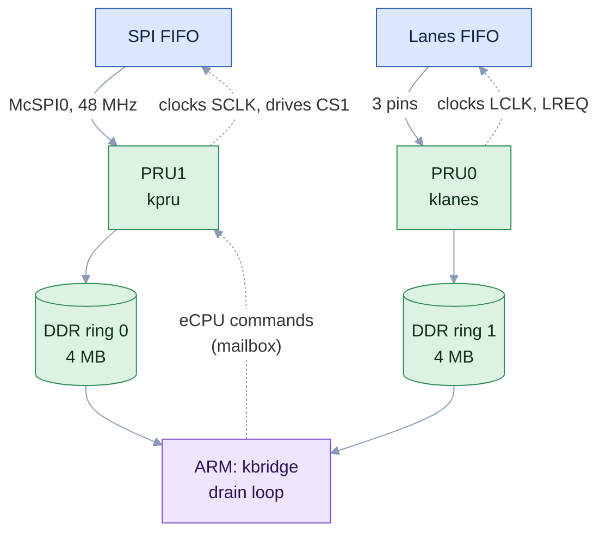
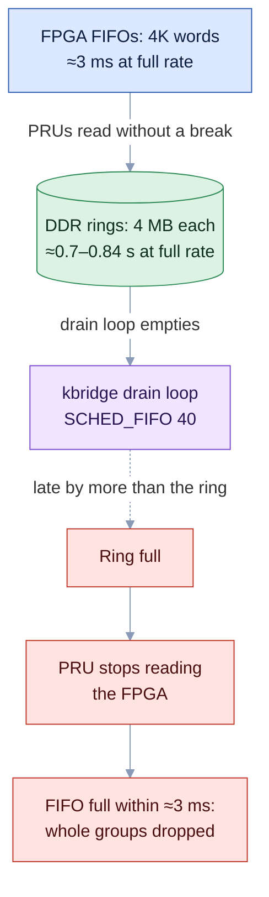
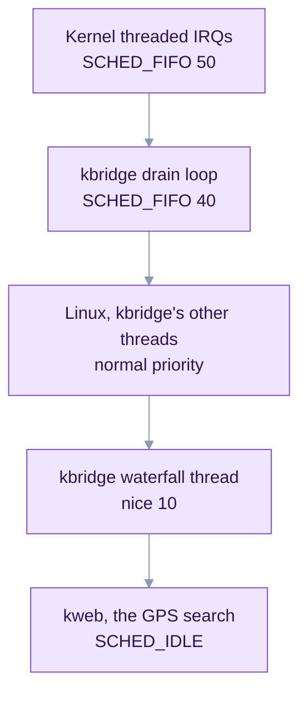
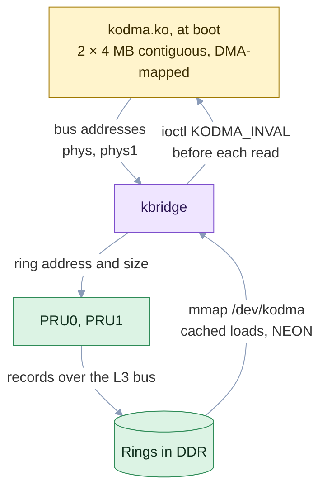

# How it works: the FPGA and the Beagle

[README](../README.md) · [the FPGA and the Beagle](hardware.md) · [the software](software.md) · [example configurations](examples.md)

How the gateware makes and packs the receivers, how the data reaches the single-core BeagleBone, and why that
needs a kernel module. The software that runs on it is in [part two](software.md).

## 1. The FPGA

The stream gateware is KiwiSDR's design with its receiver replaced: `gateware/stream/receiver_stream.v` takes the
place of `rx/receiver.v`. It is built with `RX_CFG = 2` and `USE_STREAM` (`make_proj.tcl --stream`). The stock
eCPU, its SPI command port and the GPS correlators are kept.

**The data path:**

| Block | Verilog | Details |
|---|---|---|
| ADC (on the board) | LTC2248 | 14-bit samples at 66.6666 MHz (`ADC_DATA`, `ADC_CLKIN`) and an overrange flag (`ADC_OVFL`) |
| Overload counter | `receiver_stream` | counts samples with `ADC_OVFL` set; kbridge reads it 4 times a second (`CmdGetADCCtr`) |
| Input register | `kiwi.v`, `receiver_stream.v` | `ADC_DATA` registered twice on `adc_clk` (66.6666 MHz) in `kiwi.v`, then widened to 18 bits (four zero LSBs) in `receiver_stream.v` |
| NCO + mixer (×13) | `IQ_MIXER` | 48-bit phase increment, 15-bit sin/cos, 18 × 18 multiply → 18-bit I/Q |
| CIC (×13) | `WB_CIC_IQ` | 5 stages, decimation R = 18..256 (DDCs 0–3: up to 511), then a shift → 24-bit I/Q |
| FIR (one for all) | `WB_FIR_SHARED` | 63-tap CIC-compensating filter, ÷2, gain 0..8 → 16-bit I/Q with a 4-bit DDC tag. Delay lines in block RAM, 4 copies × 2 multipliers: about 6 M outputs/s shared by all DDCs |
| Packer | `WB_PACK` | block-floating-point groups, marker and SYNC groups, raw-ADC snapshots and DDC snapshots; puts each DDC's groups in its FIFO |
| DDC snapshots (v25) | `WB_SNAP_DDC` | borrows one of DDCs 9–12 while it isn't streaming: a second CIC stage (÷1..32) after its own and a 2048–8192-sample frame into the packer's snapshot buffer, for the zoomable waterfall ([below](#ddc-snapshots-v25)) |
| SPI FIFO | `STREAM_SPI` | 4K × 32-bit, dual clock, read on the Beagle's SCLK while only CS1 is low |
| Lanes FIFO | `LANE_TX` | 4K × 32-bit, dual clock, out on three pins (P8_16, P8_15, P9_24), clocked by PRU0's `LCLK` (P8_11) and `LREQ` (P8_12), oversampled at 200 MHz from an MMCM |
| Monitor | `XADC_MON` | die temperature and VCCINT/VCCAUX/VCCBRAM, carried in SYNC groups. On the KiwiSDR the XADC answers but converts nothing (its analog supply appears unpowered), so the readings carry no information ([firmware/README.md](../firmware/README.md)) |

A DDC's output rate is 66.6666 MHz / (2R): from 1.85 MS/s (R = 18) down to 130 kS/s (R = 256), or 65 kS/s
(R = 511) on DDCs 0–3. R starts at 18 because each CIC's shared comb engine needs 16 clocks per output pair (2 (N + 3)
for N = 5 stages), and the shared FIR's input latches assume a DDC delivers at most once every 18 clocks; kbridge
refuses R < 18.

**Control.** The Beagle never writes the DDC registers directly: everything goes through the stock eCPU.

The eCPU runs on `cpu_clk`: ADC_CLKIN / 4 at power-up, then the 16.368 MHz GPS TCXO once kbridge has programmed the
MAX2769B (with `gps = on`, or `ext_clock = on`). At start-up, before PRU1 owns McSPI, kbridge sends its eCPU commands
itself over `spidev0.0`: the MAX2769B programming, the clock switch, the DNA read, the first attenuator setting and
the overload counter's mode. Once the stream runs, every command goes through PRU1's mailbox.
Its existing commands are reused, so its stock code (`KiwiSDR.rx8.wf3.aout`) needs no changes. `CmdSetRXFreq` sets
a DDC's phase increment, and `CmdSetWFDecim` writes its 24-bit cfg word and resets that DDC:

| cfg bits | meaning |
|---|---|
| `[8:0]` | R, the CIC decimation |
| `[14:9]` | CIC output shift (`floor(5·log2 R) − 5`) |
| `[18:15]` | output gain 0..8 (+6 dB per step) |
| `[21:19]` | mantissa bits: 0 → 12, 1 → 10, 2 → 8, 3 → 14, 4 → 16 |
| `[22]` | enable |
| `[23]` | route to the PRU lanes (else SPI) |

The RF step attenuator (PE4312 on the KiwiSDR 2: 0–31.5 dB in 0.5 dB steps) has no command of its own. kbridge
bit-bangs it through the FPGA's global `ctrl` register with `CmdCtrlClrSet`. It selects the attenuator on the
register's serial port, shifts in 6 bits MSB first (16, 8, 4, 2, 1 and 0.5 dB) on `DA_DACLK` and `DA_DADAT`, and
pulses `DA_DALE` to latch them. The same serial port programs the MAX2769B GPS front end and reads the FPGA's DNA. Other bits of the register select
`cpu_clk`'s source and can switch off the on-board ADC oscillator for an external clock (`CTRL_OSC_DIS`).
kbridge sets the attenuator at start (`rf_attn`). kweb's admin page can change it: kweb passes the setting to kbridge
as a ring-C request (op 6, admin only) and saves it to the configuration as `rf_attn`. kbridge drives it only on boards
that have one, using kiwid's rule: a KiwiSDR 2 with a serial number from 20000 to 22999 (`rf_attn_fitted` overrides).

Channel 14 of the same command configures the ADC snapshots (enable, route, period). Channel 15 flushes both FIFOs
and selects the word format. Channel 13 (v25) takes DDC snapshots for kweb's zoomable
waterfall: see [DDC snapshots](#ddc-snapshots-v25) below. `CmdSetGenAttn`, unused in stream builds, arms `PPS_GEN` with the ADC tick of the next
GPS second; it then raises P9_26 for 100 ms.

Before any of this runs, `kbridge load` configures the FPGA over the same SPI pins in slave-serial mode (PROG_B and
INIT_B on Beagle GPIOs). It then loads the eCPU code with both chip selects low. From then on, CS0 alone is the eCPU's
command port. The design uses 98.9 % of the XC7A35T's LUTs as logic, and 48 of its 50 block-RAM tiles.

**The eCPU and the GPS receiver.** Both are kept from the stock KiwiSDR gateware, unchanged. They descend from
Andrew Holme's [Homemade GPS Receiver](http://www.aholme.co.uk/GPS/Main.htm) (2013), whose embedded CPU, GPS
correlators, C/A code generator and sampler are the basis of `cpu.v` and `gateware/gps/`. John Seamons
(ZL4VO/KF6VO) extended them into the KiwiSDR's eCPU, its SPI host interface and its GPS firmware
(`upstream/e_cpu/`, 2014–2026). kbridge's GPS engine (`bridge/kgps_run.c`, `bridge/kgps_core.h`) is a port of
kiwid's acquisition, tracking, decoding and solution code. All of this is GPL; see each file's header.

**Why 4 GPS channels are enough.** GPS correlators cost FPGA logic, and the logic is what limits the number of
receivers. KiwiSDR's own firmware made the same trade. Its configuration allows up to 12 channels
(`GPS_MAX_CHANS`, limited by block RAM), but its 8-receiver build, `rx8.wf3`, has only 8: `GPS_RX83_CHANS 8`,
noted in `upstream/kiwi.config` as "rx83: need more logic cells to fit FPGA". The stream build goes further and
keeps 4 (`RX_CFG = 2`), leaving the rest of the XC7A35T to the 13 DDCs, the shared FIR, the packer and the DDC
snapshots, which fill 98.9 % of its LUTs. The channels are for GPS L1 C/A only. Galileo E1B code memory is present, but the
demodulators are built without it (`E1B = 0`).

Four are enough because of how kbridge uses GPS. What it needs is time and the ADC clock's frequency, not
navigation:

- **Time from one satellite.** Once the antenna's position is known, each tracked satellite gives the time by itself
  (`kg_time_only`). The signal's travel time follows from the satellite's orbit and the fixed antenna position.
  The satellites' times are averaged, weighted by signal power, and one that disagrees by more than 1 ms (a bad
  subframe) is left out. One channel is the minimum; the other three add accuracy and margin. kbridge keeps a known
  position for exactly this: `gps_location`, or a survey built from its own fixes.
- **Fixes when four are up.** A full position fix needs four satellites (`kgps_core.h`), so with 4 channels all of
  them must be tracking. Fixes are used to build the survey and to get time before a position is known. They are not
  needed once the survey has 300 fixes or `gps_location` is set.
- **The ADC clock** is measured from successive time solutions, so it needs only time, not fixes.
- **Channels go to the best satellites.** The targeted search puts free channels on the highest healthy satellites
  first, in a narrow Doppler window. A channel that loses its satellite (no data for 60 s, weak signal, or no
  navigation bits) is freed and refilled.

The cost of having only 4 channels: a first fix without `gps_location` waits until four satellites are tracked at
once, and there are fewer spare satellites to average over than with 8 or 12.

- **Front end.** The MAX2769B delivers 1-bit samples (only `I_sign` is used) at the 16.368 MHz TCXO rate, which is
  also `cpu_clk`.
- **Each channel** has a carrier NCO and a code NCO, a C/A code generator (the satellite's PRN, set by the eCPU) and
  six 20-bit accumulators: early, prompt and late, I and Q. At each 1 ms code epoch it latches them and raises a
  service request.
- **The eCPU** is a small stack CPU: 16-bit instructions and a 32-bit data stack, its code loaded over SPI at boot.
  It services each request in its main loop and runs both tracking loops in assembly (`kiwi.gps.asm`):
  - the carrier loop, from the prompt I × Q error, writes the carrier NCO;
  - the code loop, from early power minus late power, writes the code NCO.

  Both loops use a proportional-integral filter made of shifts. The eCPU also keeps the sign of prompt I as
  navigation data in a per-channel bit buffer.
- **The sampler** captures 64K bits of raw samples for the satellite search.
- **The clock snapshot** latches every channel's code phase together with the 48-bit ADC tick (a copy resynchronised
  into `cpu_clk`, a few clocks behind the live counter: a fixed offset). Position and time are solved from it.
- **kbridge** talks to all of this through eCPU commands, sent through PRU1's mailbox once the stream runs (what it does
  with the results is in [GPS, the ADC clock and time](software.md#6-gps-the-adc-clock-and-time)):
  - Its I/O thread reads each busy channel's state every 250 ms (`CmdGetChan`) and decodes subframes into
    ephemerides.
  - Every 1.5 s it takes a clock snapshot (`CmdGetClocks`), solves position and time, and measures the ADC clock
    against GPS.
  - When a channel is free, it captures 4 ms of samples for the acquisition thread. That thread searches one PRN per
    capture with FFTs, at idle priority (`SCHED_IDLE`), so it only ever uses spare CPU. It sends no eCPU commands.
  - The results go to chrony (time), to `PPS_GEN` (the 1 PPS) and to the ADC-tick-to-UTC map that timestamps every
    sample.

**The search's CPU cap.** The satellite search is the one heavy GPS job: correlating 4 ms of samples against a PRN
over a range of Doppler bins with FFTs. Tracking costs little, because the FPGA and eCPU do it. The Beagle has one
core. Running at idle priority (`SCHED_IDLE`) keeps the search from delaying anything else, but on its own that is
not enough: an idle-priority thread still uses every spare cycle. Without an antenna, or with no satellite yet to
find, the search would run without stopping. kweb's CPU guard measures spare CPU from the system's idle time, so it
would see the Beagle as fully loaded and refuse web listeners. So the search has a budget of its own:

- **A duty cycle.** kbridge measures each search's own CPU time (`CLOCK_THREAD_CPUTIME_ID`). It waits
  `cpu × (1 / duty − 1)` before starting the next one, so on average the search uses `gps_search_cpu` (default 10 %)
  of the core, whatever each search costs. For example, a search that takes 0.2 s of CPU is followed by 1.8 s of
  nothing.
- **Only while a channel is free.** With all 4 channels tracking, there is no search at all.
- **Search only where it can find something.** Once kbridge has a position and an almanac covering 8 or more
  satellites, it searches only healthy satellites above 5° elevation, highest first. Each search covers a narrow
  Doppler window around the prediction: ±1.5 kHz while the TCXO's offset is unknown, ±750 Hz with the last run's value,
  ±500 Hz once it has been measured. PRNs missing from a partial almanac are tried blind, in turn. When nothing is left to find, the search
  stops. A PRN that wasn't found is not tried again for 60 s, doubling up to 300 s. A blind sweep of all
  32 PRNs that finds nothing is followed by a 20 s pause. A full blind sweep runs as a safety net at most every
  10 minutes: with no channel tracking, no acquisition for 5 minutes, and not in the first 5 minutes after start.
- **Confirm before tracking.** A hit is checked once more on fresh samples, over ±1 Doppler bin, before a channel
  starts tracking it. The confirmation does not wait for the duty cycle.

kweb's admin page shows the search's actual CPU use.

**Packing (`WB_PACK`).** kbridge selects the block-floating-point format (`pack = on`). Each DDC's samples are
collected into groups of 512 bits (16 words) that share one exponent. The mantissa size sets how many samples fit
in a group:

| mantissa | samples per group | bits per complex sample |
|---|---|---|
| 16 | 15 | 34.1 |
| 14 | 18 | 28.4 |
| 12 | 21 | 24.4 |
| 10 | 25 | 20.5 |
| 8 | 31 | 16.5 |

Every group starts with `[511:508]` the DDC tag and `[507:504]` the exponent: 0 up to 16 − mantissa bits (0–8). The
values `E` and `F` mark special groups that share the same stream:

- **Marker (`F`).** Sent when a DDC leaves reset, before its first new sample. It carries an epoch, the new cfg word
  and the 48-bit ADC tick of the release. The receiver therefore knows exactly where a retune or resize takes effect,
  and the precise time of every later sample.
- **SYNC (`E`).** Sent before a DDC's first group and then every 128 groups. It carries the group number, so sample
  counting and timing survive a dropped group. Its spare bits carry the XADC readings (see the Monitor row above).
- **Snapshot (tag 15, type 1).** Every 100 ms (`snapshots = 100`), 16 384 raw ADC samples are captured into block
  RAM. They are sent as 547 groups of up to 30 samples at the lowest priority, and kbridge turns them into the full-band
  waterfall (see [The full-band spectrum](software.md#5-the-full-band-spectrum)).

- **DDC snapshot (tag 15, type 2, v25).** A frame of 2048, 4096 or 8192 complex samples from a borrowed DDC (below),
  sent through the same buffer and at the same low priority as type 1. kbridge always asks for 2048.

A data group is written only if its FIFO has room for all 16 words; otherwise the whole group is dropped and counted,
so the stream always stays aligned to 16-word groups. Markers and SYNC groups are never dropped: they wait for room.

#### DDC snapshots (v25)

A raw snapshot gives the full band in 4 kHz bins. For a zoomed view, kbridge can borrow one of the last four DDCs
(9–12) while it is disabled (not streaming) and take a decimated snapshot from it: a frame of complex samples at any
centre and width, captured into the same snapshot buffer and drained as chunk type 2 (`wb_snap.v`, `WB_SNAP_DDC`).
One frame per command, so one DDC can serve many users' views in turn, retuned for each.

Per frame kbridge sends: `CmdSetRXFreq` for the DDC (its centre), its cfg word with enable = 0 (R1 and the CIC shift
only; no stream, marker or epoch follows), and `CmdSetWFDecim` channel 13:

| ch 13 bits | meaning |
|---|---|
| `[0]` | go: 1 = capture one frame (a new go while busy restarts), 0 = stop |
| `[2:1]` | the DDC: 9 + this |
| `[7:3]` | R2 − 1: a second CIC stage (5 stages, R2 = 1..32) after the DDC's own; total decimation R1 × R2 up to 8192 |
| `[13:8]` | output shift: sample = sat16(v >> shift). Unity gain: 8 (R2 = 1), 8 + 5·log2 R2 (R2 a power of two); lower = more gain |
| `[15:14]` | frame size: 0 → 2048, 1 → 4096, 2 → 8192 complex samples |
| `[16]` | route the chunks to the PRU lanes (else SPI) |

The DDC's CIC is reset when the capture starts and its first 5 outputs are dropped (the filters' fill). A frame is
dropped at once, with nothing sent, on a stop, a FIFO flush, or an enabling cfg write to that DDC: the host or a
listener taking the DDC preempts the snapshot with no extra command. The second stage runs sequentially, so R1 must
leave it time: R1 ≥ 7 + 2(c + f) with R2 = 1, R1 ≥ 27 + 2(c + f) with R2 > 1 (c = shift / 8, f = shift mod 8).
With R2 = 32 the DDC's CIC shift must be at least the unity one, so the 48-bit second stage cannot overflow.

Chunk word 0 is `{4'hF, 4'h2, frame id[7:0], shift[5:0], chunk[9:0]}`; words 1–15 are one complex sample each,
`{I[15:0], Q[15:0]}`, zero past the end of the frame (137, 274 or 547 chunks). The frame id counts completed frames.
Only the inner half of a frame's spectrum is clean (aliases 48 dB down at its edge), and the CIC droop there is
4.6 dB, which kbridge corrects per bin. Spans wider than about 2 MHz stay on the raw snapshot.

**How kbridge uses them.** The four DDCs are dual-purpose: a listener or the host can have any of them as a normal
streaming receiver, and while none does, kbridge uses the highest free one for snapshots. It asks for frames of 2048
samples (1024 clean bins) at R = ⌊66.67 MHz / (2 × span)⌋, from R = 17 (a 1.96 MHz view) to 8192 (about 4.1 kHz),
retuned for each user's view in turn, and turns each frame into one waterfall row
([The zoomable waterfall](software.md#the-zoomable-waterfall-ddc-snapshots)). A frame lasts 2048 R / 66.67 MHz,
about 1024 / span seconds: 1 ms for a 1 MHz view, 16 ms for 65 kHz, 250 ms for 4 kHz. Its 137 chunks are 70.1 kbit
on SPI, so 100 frames a second, kbridge's limit, take 7.0 Mbit/s at the packer's lowest priority. They need the
raw snapshots on SPI as well (`snapshots = 100`, not `100:L`), since kbridge only takes snapshot chunks out of the
SPI stream.

**Bit depth: 8 to 16 bits, and why 12 is usually enough.** Each DDC has its own mantissa size: 8, 10, 12, 14 or
16 bits for I and for Q (cfg bits `[21:19]`). The input to the packer is always the FIR's 16-bit I/Q. For each group,
`WB_PACK` picks the smallest exponent e that makes the group's largest |I| or |Q| fit an M-bit signed mantissa.
Every sample in the group is then sent as `round(x / 2^e)`, saturated to M bits. Three things follow:

- **Small groups are exact.** If a group's peak already fits in M bits, then e = 0 and the samples go out unchanged.
  At 12 bits that is every group whose peak is below 2047, 24 dB under the FIR's full scale. At 10 bits the
  threshold is 36 dB under; at 14 bits 12 dB under; at 16 bits, always.
- **Big groups lose only relative precision.** When e > 0, the rounding error is at most half a step, 2^(e − 1),
  against a peak of about 2^(M − 1 + e). Each group therefore carries about 6 dB per mantissa bit of range below its
  own peak (about 72 dB at 12 bits), and that range follows the signal from group to group (15–31 samples).
- **A narrow channel sees only part of the error.** Rounding noise spreads over the whole slice. A 3 kHz channel cut
  from a 192 kS/s slice sees about 18 dB less of it (10·log10(192/3)) than the full slice does.

So 12 bits loses nothing on quiet groups and keeps roughly 72 dB under the strongest signal of each group, more in a
narrow channel. That is why 12 is the default for the host (`--bits`, `:b<bits>` on a slice) and what kbridge gives
kweb's DDCs. It costs 24.4 bits per complex sample, against 32 for plain 16-bit I/Q. The other sizes are for the
cases at either end:

- **10 bits** (20.5 bits per sample) suits narrow or quiet bands where link capacity matters more. The example
  configuration uses it for 2200 m, 630 m and several others.
- **14 bits** (28.4) suits a slice that holds very strong and very weak signals in the same instant, such as a
  broadcast band next to a weak one.
- **16 bits** (34.1) is the FIR's output exactly, for measurements, at 40 % more link than 12.
- **8 bits** (16.5) is the cheapest, for monitoring.

The cost of each size on the links is in the table under [Flexible bandwidth and bit depth](#1-the-fpga).

**Leaving the FPGA.** Each DDC's groups go to one of the two FIFOs, chosen by cfg bit 23:

- **SPI (`STREAM_SPI`).** It is read by the Beagle's McSPI at 48 MHz, using the chip-select combination stock
  firmware never uses (CS1 low, CS0 high). Each transfer starts with a header (overflow flag, drop count, words
  available) and the read index.
- **PRU lanes (`LANE_TX`).** Three spare pins carry one bit each per clock, clocked by the PRU through `LCLK`/`LREQ`.
  A 200 MHz clock from an MMCM oversamples them, because none of these pins is clock-capable. Transfers use the same
  header and the same consumption rules as SPI.

**Flexible bandwidth and bit depth.** Each DDC has three settings of its own: R (its bandwidth), the mantissa size
(its bit depth) and its route (SPI or lanes). Any of them can change while the stream runs, without disturbing the
other DDCs.

**Why only 80 % of a DDC's rate is used.** The CIC's response droops across its band, and its edges are not steep.
The FIR after it is designed to fix both (`gateware/stream/wb_fir_coefs.vh`). It corrects the droop and is flat over
0–0.2 of its input rate, rolls off between 0.2 and 0.3, and stops from 0.3 to 0.5. After it decimates by 2, that is a
flat band of ±0.4 of the DDC's output rate: 80 % of it. Its transition band (0.4–0.6 of the output rate) folds back
only onto the outer 10 % at each edge, which nothing uses. Every part of the software therefore asks for, and uses,
only the middle 80 %:

- **kbridge** takes a *usable* width in every request and picks the smallest rate that holds it:
  `R = floor(33.3333 MHz / (width / 0.8))`.
- **kweb** gives band windows and receiver widths in the configuration as usable kHz, and converts them with the
  same formula. A host slice counts as covering a band only if the band lies inside its ±0.4 × rate. A VFO plays only
  if its whole filter passband lies inside the source's ±0.4 × rate; otherwise it is parked and muted.
- **kiwi-hpsdr-bridge** asks for a usable width equal to the HPSDR client's sample rate, so the rate it gets is 1.25×
  higher or more. It then resamples to the client's exact rate with a 64-tap Kaiser-windowed sinc, flat to 0.45 of
  the output rate:

  | client rate | slice | R |
  |---|---|---|
  | 48 kHz | 65.2 kS/s | 511 |
  | 96 kHz | 120.3 kS/s | 277 |
  | 192 kHz | 241.5 kS/s | 138 |
  | 384 kHz | 483 kS/s | 69 |

  48 and 96 kHz receivers need R > 256, which only DDCs 0–3 can do. When those four are taken, the bridge asks for
  a 104 kHz slice (R 256) instead, which any DDC serves, and still resamples it to the client's exact rate.

The cost of a DDC on its link is its rate × 512 / S bits, where S is the number of samples per group:

| R | rate | usable width | 8 bit | 10 bit | 12 bit | 14 bit | 16 bit | FIR: DDCs at this R |
|---|---|---|---|---|---|---|---|---|
| 18 | 1852 kS/s | 1481 kHz | 30.6 | 37.9 | 45.1 | 52.7 | 63.2 | 2 |
| 24 | 1389 kS/s | 1111 kHz | 22.9 | 28.4 | 33.9 | 39.5 | 47.4 | 3 |
| 32 | 1042 kS/s | 833 kHz | 17.2 | 21.3 | 25.4 | 29.6 | 35.6 | 4 |
| 43 | 775 kS/s | 620 kHz | 12.8 | 15.9 | 18.9 | 22.0 | 26.5 | 6 |
| 64 | 521 kS/s | 417 kHz | 8.6 | 10.7 | 12.7 | 14.8 | 17.8 | 9 |
| 87 | 383 kS/s | 307 kHz | 6.3 | 7.8 | 9.3 | 10.9 | 13.1 | 13 |
| 128 | 260 kS/s | 208 kHz | 4.3 | 5.3 | 6.3 | 7.4 | 8.9 | 13 |
| 174 | 192 kS/s | 153 kHz | 3.2 | 3.9 | 4.7 | 5.4 | 6.5 | 13 |
| 256 | 130 kS/s | 104 kHz | 2.2 | 2.7 | 3.2 | 3.7 | 4.4 | 13 |
| 511 | 65 kS/s | 52 kHz | 1.1 | 1.3 | 1.6 | 1.9 | 2.2 | 4 (DDCs 0–3) |

The bit-depth columns are Mbit/s. The last column is how many DDCs all at that R the shared FIR can serve.

Before kbridge programs a DDC, the new set of DDCs has to pass these checks:

- **A DDC.** There are 13 in all, and R > 256 needs one of DDCs 0–3. Each user (host or web) is also held to its
  `[pool]` share. DDCs 9–12 count as free while they only take DDC snapshots: enabling one for a slice stops the
  snapshot at once.
- **The FIR's schedule.** The shared FIR takes about 10 clocks per output and serves the lowest-numbered DDC first.
  Every DDC must be served before its next output is due, 2R clocks later. kbridge checks this with a response-time
  analysis (`fir_sched_ok`) for the whole set, and picks the DDC number so that it passes. If none passes, a web
  request is refused; a host slice is still programmed on the first possible DDC, with a warning ("expect drops"). The table's last column is
  the result for identical DDCs; mixed sets are checked as they are.
- **The link.** Each link has a budget: SPI 40 Mbit/s (`spi_max`), lanes 45 Mbit/s (`lane_max`), and 87 Mbit/s for
  both together (the Ethernet). The waterfall snapshots take about 2.8 Mbit/s of SPI. The zoomable waterfall's DDC
  snapshots are not in the budget: they use what is left of SPI at the lowest priority, so they can slow down but
  never push a slice out, and kbridge cuts them to 20 frames/s while the budgeted SPI traffic is over 33 Mbit/s. A slice must fit on one link, so
  the widest one (R = 18) fits at 10 bits (37.9 Mbit/s) on the lanes, or on SPI only with the snapshots off or moved to
  the lanes (2.8 + 37.9 > 40), and not at 12 bits (45.1) on either.
- **For web DDCs, nothing the host needs.** If a web DDC would make the FIR late, it is refused. If a host request is
  refused while kweb holds DDCs, kbridge takes back all of kweb's DDCs and tries again; the host's first slice on
  the lanes also takes back every web DDC there. kweb's DDCs use SPI, and the lanes only when SPI is full and the
  host isn't using them.

A change then reaches the FPGA, and the stream, like this:

`CmdSetRXFreq` changes the NCO at once (in two writes, the high and low halves), so the few samples between it and the
cfg write are already at the new frequency but still belong to the old segment. The cfg write resets that DDC alone,
and the packer drops the DDC's partial and unsent groups and sends a marker before the DDC's first new group. The marker carries the epoch, the new cfg word
and the ADC tick of the reset release, so whoever reads the stream switches rate and bit depth at exactly that point.
That is kweb through its tap's segments, and the PC from the marker itself. The changed DDC loses the groups it
dropped, and its first ~16 outputs after the release are filter start-up: the CIC restarts from zero and the FIR's
delay line is not cleared (the HPSDR bridge discards 40 samples for this). The other DDCs carry on: PRU1 slots the
eCPU commands between its stream reads, and the FPGA's FIFOs hold the stream in the meantime. When a slice moves to another DDC (to keep the FIR schedule), the
new DDC is started before the old one is stopped.

## 2. Into the BeagleBone

The BeagleBone's AM335x has a **single Cortex-A8 core** (1 GHz), shared by kbridge, kweb and Linux. It also has two
200 MHz PRUs, small real-time cores with their own memory and direct access to pins. Moving 80 Mbit/s with the ARM,
through SPI interrupts or by bit-banging pins, would use up that one core. Instead the PRUs run small C programs
(`pru/`) that do all the per-word and per-bit work:

- **PRU1 (`kpru.c`, built for PRU1; with `lanes = off` the SPI stream runs on PRU0 instead)** drives McSPI0 directly
  at 48 MHz, using channel 1 with its FIFOs. It drives the FPGA's CS1 itself on GPIO1_19 (P9_16), because McSPI's own
  CS1 pin isn't wired to the FPGA. It probes the FPGA's header (2 words); once at least 1024 words are waiting, it
  reads the header, the read index and up to 2048 words in one CS1 transfer. It also performs the eCPU commands the
  ARM places in a mailbox, driving CS0 itself so that a command never overlaps a stream transfer. While the stream
  runs, only the PRU touches McSPI. Short commands go at 12 MHz between stream reads. Long ones (GPS sample reads,
  about 4 kB, at 24 MHz) stop the stream while they run and are spaced at least 8 ms apart, so the 4K-word FIFO never
  fills.
- **PRU0 (`klanes.c`)** raises and lowers `LCLK`, samples the three lane pins on each clock and packs 10 samples
  (30 bits) into each 32-bit word. It samples into the PRUs' on-chip shared RAM and copies each finished record to
  DDR, because a DDR write inside the sampling loop would stall it.

Both write records into physically contiguous 4 MB DDR rings from the `kodma` kernel module (ring 0 for SPI, ring 1
for the lanes): about 0.84 s of SPI at 40 Mbit/s, and 0.7 s of lanes at 45 Mbit/s (each ring word carries 30 data
bits). The PRUs pull the data, since they clock both links; the FPGA cannot push. There are no interrupts. The ARM polls
the PRUs' write counters and accepts a record only once its trailer word has landed (writes from one bus master
arrive in order).
Each record carries the FPGA's read index, so the ARM can see any gap. The PRUs only ever write DDR: a PRU read from
DDR once froze the whole SoC.

How the rings are allocated, and why they are mapped cached, is in [The kernel module](#3-the-kernel-module-kodma).

What is left for the ARM is reading memory, and as little of it as possible:

- **SPI records**: the drain loop finds the 16-word group boundaries, checks the read indices, takes out the snapshot
  chunks (raw and DDC) and forwards the rest.
- **Lanes records** go to the host as they are (`'KOL2'` frames), and only while the host has a lanes slice. The PC
  turns the 3-bit samples back into words. On the Beagle, kbridge decodes only each group header's top byte (tag and
  exponent) and the groups of the slices kweb taps, about 25 ns per word with NEON. With no tap on a lanes slice it
  decodes nothing.

Everything else in kbridge, and all of kweb, uses the time that remains.

**Why the drain loop runs at real-time priority.** The stream never stops: the FPGA produces it whether or not anyone
reads it. Each buffer along the way has a fixed depth, and only the last one is the ARM's to empty:

Who runs first on the one core, highest first:

- **The PRUs never wait for the ARM, until the ring is full.** A PRU writes a record only if the ring has room. When it
  doesn't, the PRU stops reading the FPGA. The FPGA's 4K-word FIFO then fills in about 3 ms (4096 words at 38–45
  Mbit/s), and the packer starts dropping whole groups. They are counted in the header's drop count, and downstream
  sees a gap.
- **So the ARM may be late by up to about a second, but never longer.** A 4 MB ring holds about 0.84 s of SPI at
  40 Mbit/s. On the lanes it holds about 0.7 s at 45 Mbit/s, because each ring word carries 30 data bits. At normal priority, a
  busy second on the single core is enough to cross that. One such stall was logged on 2026-11-26 (the SPI ring full,
  4881 groups dropped, nothing else wrong), and that is why real time is on by default (`[kbridge] realtime`).
- **kweb sits below everything.** kweb runs every thread at `SCHED_IDLE`, so if the CPU runs short its audio
  stutters, not the host's stream. At nice 5 it still took about 25 % against the drain loop, which then fell behind
  on the lanes ring until it overflowed. The GPS search is `SCHED_IDLE` too, and the waterfall thread runs at
  nice 10.
- **Real time without starving the system.** An earlier real-time drain loop that spun starved the network softirqs:
  the Beagle stopped answering pings. The loop now:
  - sleeps whenever the rings are empty, for 10 ms at a time, which the rings easily cover;
  - runs at priority 40, below the kernel's threaded interrupt handlers (50), so the kernel's interrupt threads (the network's among them) still
    preempt it;
  - lives under the kernel's real-time throttling (`sched_rt_runtime_us` 950000), which keeps 50 ms of every second
    for everything else;
  - locks its memory (`mlockall`), so a page fault never stalls it.

  Threads it starts go back to normal priority.

## 3. The kernel module (kodma)

`kodma` (`kmod/kodma.c`, about 150 lines) is the one piece that has to run in the kernel. It gives the two PRUs
somewhere large to write: two 4 MB rings in DDR that user space can read.

**Why it is needed.**

- **On-chip memory is far too small.** Without kodma, a PRU's ring is the 12 KB of PRU shared RAM: 3072 words,
  about 0.6 ms of SPI stream at 38.4 Mbit/s. The ARM would have to empty it every half millisecond, which a
  single-core Linux system cannot guarantee. 4 MB in DDR gives it 0.7–0.84 s (see
  [why the drain loop is real-time](#2-into-the-beaglebone)).
- **The PRUs need physical memory that nothing else uses.** They write to bus addresses, so the buffer must be
  physically contiguous, known by address and owned by nobody else. User space cannot allocate such memory. The
  alternatives through `/dev/mem` are both worse:
  - memory outside Linux's RAM maps strongly ordered, about 60 MB/s;
  - any fixed address inside Linux's RAM would let the PRUs write over the kernel.
- **The caches have to be handled.** The PRUs write DDR behind the Cortex-A8's caches, which do not see those writes.
  Someone has to invalidate the cache lines before the ARM reads them, and only the kernel can do that.

**What it does.**

- At load time it allocates each ring with `alloc_pages` (order 10: 4 MB, physically contiguous, zeroed) and maps it
  for DMA once.
- It publishes the bus addresses as the read-only module parameters
  `/sys/module/kodma/parameters/phys` and `phys1`. kbridge passes them to the PRUs' control blocks.
- It offers `/dev/kodma`, which kbridge maps (8 MB, both rings) and reads directly.
- Its only call is `ioctl(KODMA_INVAL, {offset, length})`, which runs `dma_sync_single_for_cpu` on exactly that
  range. kbridge makes it for each range before reading it.
- There is no write path: the ARM never writes the rings.

**Cached, not uncached, DDR.** The obvious way to share a DMA buffer is to map it uncached (`dma_alloc_coherent`), and
the first versions did. It has two problems on the Cortex-A8:

- **NEON loads hang the ARM.** NEON loads from Normal non-cacheable memory freeze the Cortex-A8 outright: the ARM
  stops dead with no oops, no log and no watchdog message, while the PRUs keep running. Before this was understood,
  the freezes were blamed on the PRUs' SPI and GPIO handling.
- **Plain loads are too slow.** 32-bit uncached loads are safe but cost about half the CPU at 77 Mbit/s.

`kodma` therefore allocates each ring as ordinary cacheable memory (physically contiguous, DMA-mapped once), and
kbridge maps it cached. Before reading a range the PRU has written, kbridge invalidates exactly those cache lines
(`ioctl(KODMA_INVAL)`, `dma_sync_single_for_cpu`). The ARM never writes the rings, so no line is ever dirty. Cached
loads are fast, and NEON is safe on them. If the 4 MB allocations fail when the module loads, it falls back to the
uncached buffer. kbridge then reads it with plain 32-bit loads only, never NEON.

A kernel module must match the running kernel exactly, so releases carry kodma's source, not a binary.
`tools/install.sh` builds it on the Beagle against the installed kernel headers, installs it as
`/lib/modules/<kernel>/extra/kodma.ko` and loads it at boot through `/etc/modules-load.d/kodma.conf`. After a
kernel update, run the installer again; building it by hand is described under [The kernel module](../README.md#the-kernel-module)
in Building. kbridge uses the rings when `ddr = on` (the default) and stops with a clear message if the module is
missing.
