# How it works: the software

[README](../README.md) · [the FPGA and the Beagle](hardware.md) · [the software](software.md) · [example configurations](examples.md)

kbridge, the full-band spectrum, GPS and time, kweb, the network, the HPSDR bridge, NEON and the bottlenecks. The
FPGA and the data path into the Beagle are in [part one](hardware.md).

## 4. The ARM: kbridge

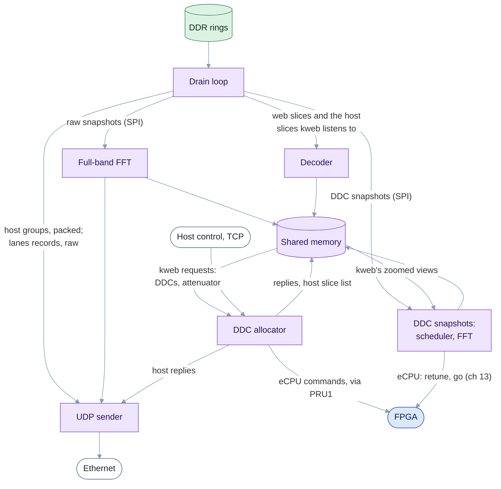

kbridge loads the bitstream and the eCPU code, then runs the stream. Its drain loop sorts the groups:

- **Snapshot chunks** (on SPI) go to a low-priority thread that computes the full-band waterfall: a 16 384-point real
  FFT (pffft, NEON), an average, and 8192 bins in 0.5 dB steps. They are removed from the stream rather than forwarded
  (a host can ask for the raw chunks as well).
- **DDC snapshot chunks** (v25, on SPI) are removed too and assembled into frames for the zoomable waterfall. Their
  scheduler runs in the drain loop: it retunes a spare DDC of 9–12 to each user's view in turn and turns each frame
  into a row for kweb ([The zoomable waterfall](#the-zoomable-waterfall-ddc-snapshots)).
- **Groups of host slices** stay packed and go to the processing host in UDP datagrams (`'KOD1'`): SPI data as
  word frames (`'KOW2'`), lanes records raw (`'KOL2'`). kbridge's replies to the host (`'KOS1'`) travel in the same stream. TCP on
  the same port (9073) carries control; a host can also take the data over TCP instead, but the HPSDR bridge uses UDP.
- **Groups of kweb's slices**, and of host slices kweb listens to, are decoded to int16 I/Q into shared-memory taps.
  (The host slices' groups are copied: they still go to the host.) Each tap has segments saying which DDC, epoch,
  rate, bit depth and centre frequency apply from which sample, and whether a gap came before; its timing anchors are
  kept beside them.

The shared memory (`/kiwi-offload-kweb`, layout in `bridge/kshm.h`) holds the I/Q taps, the waterfall rows (ring B
for the full band, ring E for the DDC snapshots), kweb's requests (ring C, also its zoomed views), kbridge's replies
(ring D), the list of the host's slices, the GPS status and the time map.
One allocator serves requests from the host (TCP) and from kweb, with the checks described under
[Flexible bandwidth and bit depth](hardware.md#1-the-fpga), and answers on ring D, for example "link full: …". Host slices take
precedence: kweb's DDCs are taken back ("preempted") when the host needs them. kbridge's GPS I/O thread tracks
satellites through eCPU commands and solves time and position; its acquisition thread only runs FFTs. Arming the
1 PPS and retuning the DDCs to the measured ADC clock happen in the drain loop's housekeeping (`gps_tick`).

## 5. The full-band spectrum

The full 0–33.3 MHz waterfall comes from the same two links as everything else. The ADC's raw stream (14 bits at
66.67 MS/s, about 933 Mbit/s) could never leave the board, so the FPGA sends short raw snapshots instead, at the
lowest priority, and the ARM does the FFT. This works with the snapshots on SPI, the default; kbridge takes them
out of the SPI stream only.

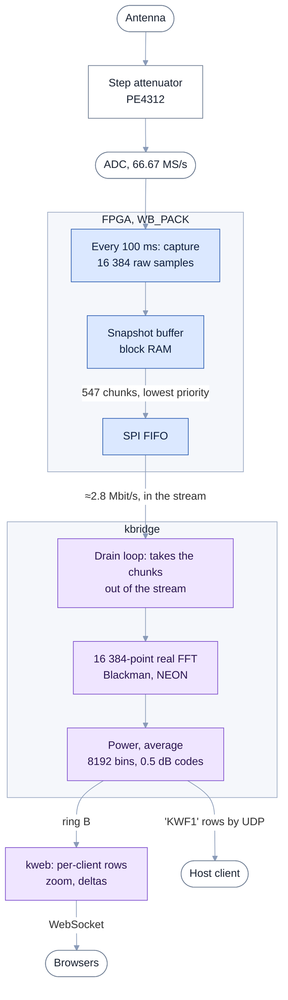

- **Capture.** Every 100 ms (`snapshots = 100`), `WB_PACK` captures 16 384 consecutive raw ADC samples at the full
  rate (about 246 µs of signal) into a block-RAM buffer, two 16-bit samples per word.
- **Trickle.** It sends them as 547 chunk groups (tag 15, type 1, up to 30 samples each), only when no data group,
  marker or SYNC is waiting and its FIFO is at most a quarter full (1024 words), so the DDCs always keep three
  quarters of it. A snapshot is 280 kbit, so 10 a second cost about 2.8 Mbit/s of
  SPI: 7 % of that link, for a view of the whole HF spectrum.
- **Out of the stream.** kbridge's drain loop finds the chunks by content and removes them from each record in
  place. It then lowers the record's FIFO index by the words it removed, so the host still sees an unbroken word
  stream with the group phase unchanged.
- **The FFT.** A complete snapshot goes to a low-priority thread (`kb-waterfall`, below the drain loop and the UDP
  sender). It removes DC, applies a Blackman window and runs a 16 384-point real FFT (pffft, NEON). The result is
  8192 bins of 4.07 kHz from 0 to 33.3 MHz. Power is averaged from row to row (an exponential average, α = 0.35) and
  coded as `round((dBFS + 140) × 2)`, 0.5 dB per step. If the thread is still busy when the next snapshot completes,
  that snapshot is dropped and the next row says so.
- **Out to the users.** Each row goes into ring B for kweb. kweb reduces it to each browser's pixel width (the
  maximum of the bins under each pixel) and sends full rows or deltas. For the host, rows go out as `'KWF1'` frames
  in the UDP stream: a full row (8192 bytes) at the start, after at most 50 deltas, on request, and whenever a delta
  would be no smaller; otherwise a delta. A delta is a 1-bit-per-bin mask plus one byte for each bin that changed by 3 dB or more, and names the row it
  applies to, so a client that lost a row asks for a full one and never shows a wrong row.

A snapshot is about 246 µs of signal every 100 ms, so the waterfall samples the band rather than watching it
continuously. A short burst between snapshots can be missed. The narrow waterfalls and the audio come from the
DDCs and see everything.

### The zoomable waterfall: DDC snapshots

The full-band rows have 4.07 kHz bins. kweb's zoomable waterfall (`[kweb] zoom_waterfall`, [section 7](#the-waterfall-on-the-page))
needs finer detail wherever a user zooms in. Inside a running receiver it uses that receiver's own samples. Everywhere
else the detail comes from **DDC snapshots** (stream gateware v25): the last four DDCs, 9–12, are dual-purpose. A
listener or the host can have any of them as an ordinary receiver, and while one is not streaming, kbridge borrows it
to capture single frames, retuned to each user's view in turn.

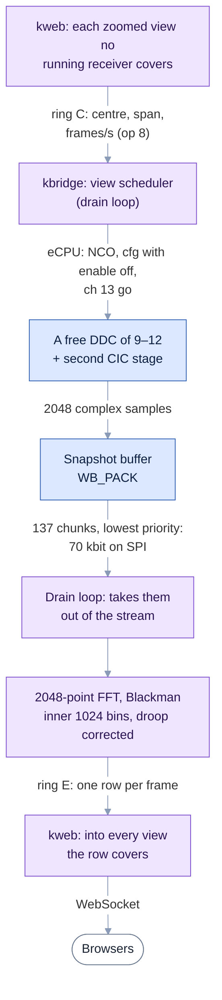

- **The views.** kweb sends kbridge every zoomed view that is finer than 2 kHz per pixel, 4.1 kHz to 1.96 MHz wide,
  and not covered entirely by a running receiver: its centre, its span and the frames per second it wants (op 8 on
  ring C). It repeats the request every 5 s; kbridge forgets a view after 15 s without one. Up to 64 views.
- **The frame.** Every frame is 2048 complex samples at R = ⌊66.67 MHz / (2 × span)⌋, from 17 to 8192 (R1 ≤ 256 on
  the DDC, the rest in the second CIC stage), so the frame's clean inner half, 1024 bins, is the view. Every user
  gets the same 1024 bins whatever their screen, so views of the same place merge. The bins are
  66.67 MHz / (2048 R) wide: 196 Hz for a 200 kHz view, 64 Hz for 65 kHz. For each frame kbridge sends the DDC's NCO
  (when the centre moved), its cfg word with enable off (when R1 changed) and the go (`CmdSetWFDecim` channel 13).
  A frame lasts 2048 R / 66.67 MHz, about 1024 / span seconds: 1 ms for a 1 MHz view, 5 ms for 200 kHz, 16 ms for
  65 kHz, 250 ms for 4 kHz. Narrow views keep the DDC busy longest. Like the raw snapshots, a frame samples its view
  rather than watching it: a 200 kHz view at 10 frames/s sees 5 ms of every 100. Inside a running receiver, the
  rows instead sum that receiver's FFTs over up to 10 blocks each: every block on a 200 kHz window.
- **The schedule.** The next frame goes to the view that is due and was served longest ago. A nearby view shares a
  frame when it still gets bins no wider than 1.3 times its own, and a finished frame serves every other view it
  covers. Each view gets up to the rate kweb asks (`zoom_fps`, 10 by default); all views together get up to 100
  frames/s on average, with 50 ms of allowance so short frames catch up after long ones. While the slices on SPI take
  more than 33 Mbit/s of its budget, the limit is 20 frames/s.
- **The DDC.** kbridge uses the highest of DDCs 12, 11, 10 and 9 that is not streaming. A listener or the host can take
  it at any time: enabling it for a slice aborts the frame inside the FPGA at once, with no extra command, and the next
  frame goes to the next free one. With all four streaming, there is no detail, and kweb shows such views the full
  band's rows (it drops back after 2 s without a row and tries again 10 s later).
- **The link.** A frame is 137 chunks, 70.1 kbit, always on SPI, at the packer's lowest priority: 7.0 Mbit/s at 100
  frames/s. It is outside the link budget, so it can slow down but never delays a receiver's groups. It needs the raw
  snapshots on SPI as well (`snapshots = 100`, not `100:L`): kbridge takes snapshot chunks out of the SPI stream only,
  and turns the DDC snapshots off without it. A host never sees them. Without v25 gateware no frame arrives, and
  kbridge turns them off by itself.
- **The row.** kbridge removes DC, applies a Blackman window and runs a 2048-point FFT (pffft, NEON). It keeps the
  inner 1024 bins, corrects both CIC stages' droop per bin (4.6 dB at the edges), averages each view's rows
  (α = 0.5) and codes them like the full-band rows, 0.5 dB per step. It sets each view's gain (the output shift) from
  the frame's peak. The rows go to kweb on ring E.
- **The cost.** Measured with ten zoomed views at about 84 frames/s in all: 5.7 Mbit/s more on SPI (68 kbit per
  frame), and kbridge 22 % more of the CPU, about 0.26 % per frame/s. kbridge's own count is about 1.35 ms per frame
  for the commands and the FFT; the rest is the drain loop handling the extra words and waking more often while a
  frame is due. kweb adds about 0.5 % per view, composing and sending its rows.

One DDC serves every view in turn, so how often a view updates depends on how many views there are and how narrow
they are. Ten users zoomed in at once, each somewhere different (seven views of 260 kHz to 1 MHz, three of 65 kHz),
each also listening to 40 m, measured 84 frames/s in all: 8.3 rows a second each. The three 65 kHz views took about
half of the DDC's time. The DDC alone gave about 88 frames/s; the CPU guard held the rate where the CPU allowed (see
below). Views of the same place share frames, so ten users looking at the same stretch of band cost one view.

## 6. GPS, the ADC clock and time

Every sample, every GPS measurement and the 1 PPS are timed by one clock: the FPGA's 48-bit ADC tick counter
(`gps.v`), which counts at the ADC's 66.67 MHz and wraps every 49 days. GPS supplies the rest: how fast that clock
really runs, and which UTC instant a given tick is.

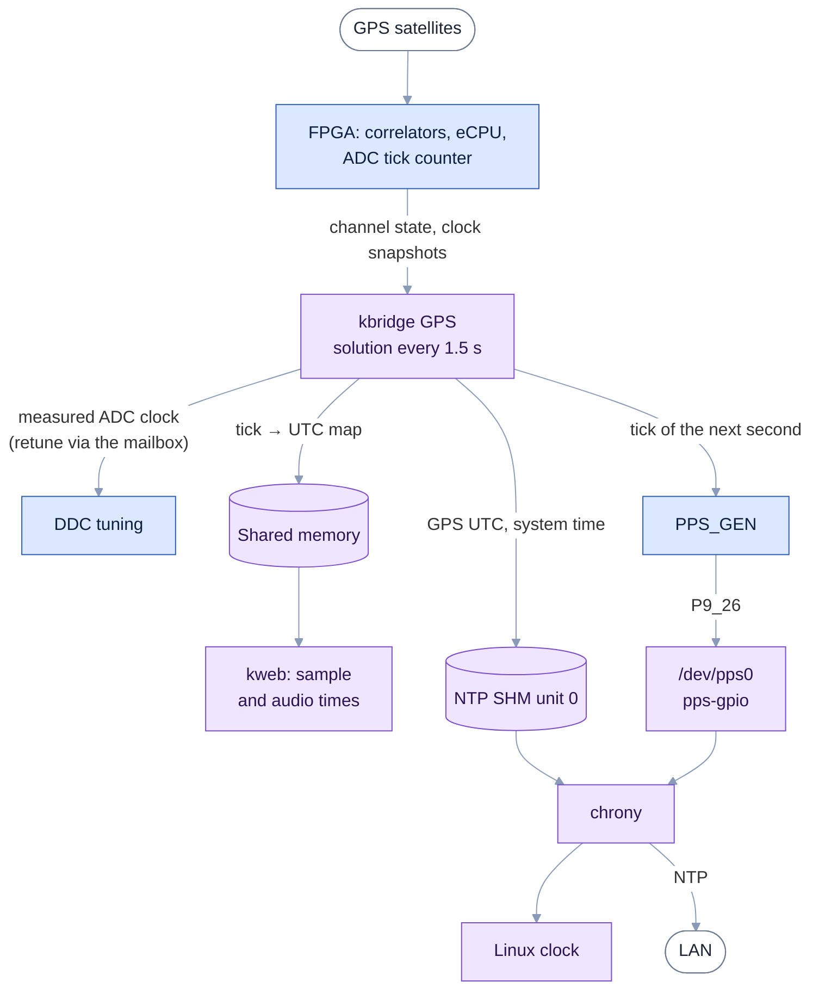

- **The clock snapshot.** Every 1.5 s, kbridge takes a clock snapshot (`CmdGetClocks`). The FPGA latches every
  channel's code phase together with the ADC tick. Solving the satellites' transmit times at that instant gives the
  receiver's GPS time at that tick. One satellite is enough when the antenna's position is known, which is why
  kbridge keeps one. In order of preference:
  - `gps_location` with the ground elevation and the antenna's height;
  - a survey (the mean of 300 or more of its own fixes);
  - `gps_location` at sea level;
  - a short survey or the latest fix.

  Each metre of height error moves the time by up to 3.3 ns.
- **The ADC clock** is measured from successive solutions (see below).
- **The tick → UTC map** (`kshm_time_t` in shared memory, behind a seqlock) is rewritten after every snapshot. It holds
  a tick, its UTC and the measured ADC clock rate: UTC at tick T = `map_utc + (T − map_ticks) / adc_hz`. Its
  source is the GPS solution (`src = 2`, sub-microsecond) or, while there is none, the system clock read around the
  same snapshot (`src = 1`, about 0.1 ms, as good as chrony's clock).
- **chrony, from GPS time.** Each precise GPS time is posted to the NTP shared-memory refclock, unit 0 (`refclock SHM
  0`), as a pair: GPS UTC and the system clock at the snapshot. The record is chrony's 80-byte layout with 32-bit
  seconds, matching chrony 4.0 on Debian 11 armhf. Its precision is set to about 1 ms, because the snapshot's timing
  passes through the PRU mailbox.
- **chrony, from the 1 PPS.** While it has a precise GPS time less than 30 s old, kbridge arms `PPS_GEN` with the ADC
  tick of the next GPS second, at least 0.3 s ahead,
  as two 24-bit halves through `CmdSetGenAttn`. At that tick the FPGA raises P9_26 for 100 ms. A device-tree overlay
  (`kiwi-offload-pps.dts`, loaded at run time through configfs) makes it `/dev/pps0` with the kernel's `pps-gpio`
  driver. `kiwi-offload-pps.service` loads the overlay before chrony starts (kbridge also loads it if it is missing). It writes chrony's `refclock PPS
  /dev/pps0 lock GPS` line only if the device exists, because chronyd exits on a missing PPS device. The GPS refclock
  numbers the pulses; the pulses' edges then hold the clock.
- **NTP out.** chrony serves the resulting time to the RFC 1918 networks (see below).

**Correcting the ADC clock in software.** The ADC runs from an on-board oscillator, nominally 66.6666 MHz. Every
frequency a DDC tunes to and every timestamp depend on it. A real oscillator is off by a few ppm and drifts with
temperature. On the KiwiSDR this was written on, GPS measures it at 66 666 345 Hz, 3.83 ppm slow. Uncorrected, a
signal at 28 MHz would appear 107 Hz from where it is, and one at 7 MHz 27 Hz. kbridge corrects for it entirely in
software, without touching the hardware:

- **Measuring.** The ADC ticks counted between two GPS solutions, divided by the GPS time between them, give the
  clock's true frequency. kbridge rejects outliers (more than 1 ppm off; 100 ppm at first) and averages the rest
  exponentially, each new measurement weighted 1/32. On this board successive averages agree to within 0.003 ppm,
  about 0.1 Hz at 28 MHz.
- **Tuning with it.** Every DDC's 48-bit phase increment is computed from the measured frequency, not the nominal one
  (`set_rx_freq`). Once there are 4 measurements, whenever the average has drifted 0.02 ppm (0.6 Hz at 30 MHz) from
  the value in use, the drain loop retunes every DDC with it, so a signal stays where it belongs as the board warms
  up.
- **Timing with it.** The tick → UTC map above converts ticks with the measured rate too, so timestamps stay exact
  between snapshots.
- **An external reference.** With `ext_clock = on` the ADC runs from the external clock input, for example a GPSDO,
  at `ext_clock_hz`. GPS then only measures and shows its offset, unless `ext_clock_gps` is set.

The GPS front end's own TCXO is measured separately, from the satellites' carrier against their predicted Doppler.
On this board it is 822 Hz low at L1 (0.52 ppm). That narrows the satellite search; it does not affect the
receivers.

**A stratum 1 NTP server for the LAN.** chrony combines the two GPS sources in the usual way for a GPS-disciplined
server:

- the shared-memory GPS time says which second it is, to within about a millisecond;
- the 1 PPS edge says exactly when each second starts;
- `refclock PPS … lock GPS` ties the two together and prefers the PPS.

With its own reference clocks, chrony runs at stratum 1 and serves NTP to the private (RFC 1918) networks; other
networks can be added with `allow` lines in a site file. Measured on this KiwiSDR with `chronyc tracking` and
`chronyc sourcestats`:

| | value |
|---|---|
| Stratum | 1, locked to the PPS |
| System clock against GPS time | 1.6 µs fast |
| RMS offset | 2.0 µs |
| The shared-memory GPS time on its own | −0.25 ms (standard deviation 65 µs): which is why the PPS is preferred |
| Internet servers (stratum 2) seen at the same time | within about 1 ms |

A client on the LAN gets the Kiwi's time as accurately as its network path and its own NTP client allow. The Kiwi's
own clock is not the limit.

**How a sample is timestamped.** A sample's time is the moment the ADC saw the signal, not the moment the sample came
out of a filter. Every delay along the way is known and taken off.

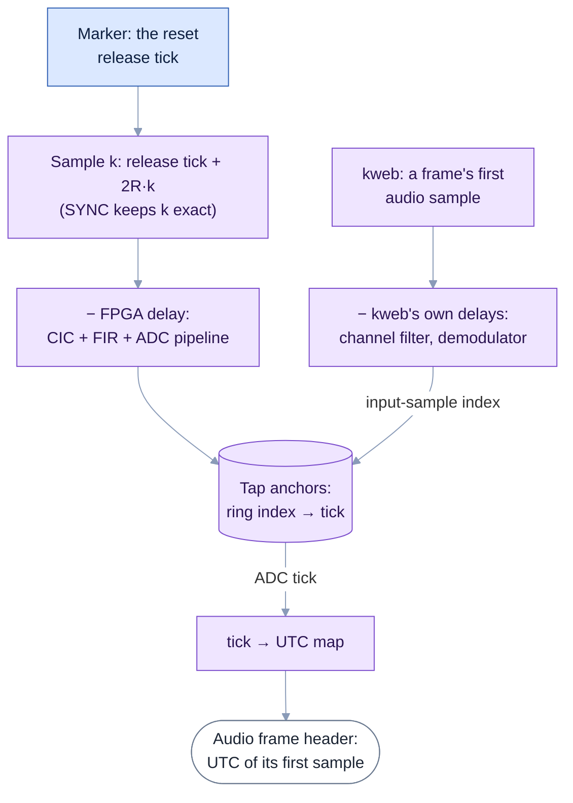

- **I/Q.** Each marker carries the 48-bit tick at which its DDC left reset. After it the DDC's samples come one every
  2R ticks exactly, so sample k after the release is at `t_release + 2R·k`. SYNC groups carry group numbers, so k
  stays exact across dropped groups. The CIC, the FIR, the ADC's pipeline and the FPGA's input registers delay the
  signal by a fixed amount for each R, and kbridge takes it off:
  `tick(k) = t_release + 2R·k + C(R) − 7`, where `C(R) = 12.5 − 32.5·R` ADC clocks.
  - `C(R)` was measured in simulation (`gateware/stream/tb_delay.v`) and fits R = 18..140 with zero residuals. It is
    made up of the CIC's 2.5 (R − 1), the FIR's centre tap at 31 R, the decimation phase and register latencies.
  - The 7 is the LTC2248's 5-clock pipeline plus the FPGA's 2 input registers.

  kbridge writes the result into each tap as anchors, pairs of (ring index, tick), after every marker and every SYNC
  group.
- **Audio.** kweb carries each VFO's input-sample time through its chain and subtracts each stage's exact delay:
  - the channel filter: linear phase, so (M − 1)/2 input samples, its centre tap;
  - the optional sharper second stage: its own centre tap;
  - the Catmull-Rom resampler: none, as it interpolates at the output point;
  - the demodulator: 15 samples for SAM (its 31-tap Hilbert transform), half a sample for FM plus the de-emphasis
    (12.3 samples at DC, so exact only for slow modulation), none for AM, SSB and CW.

  The time of each 20 ms frame's first audio sample becomes an input-sample index. The tap's anchors turn it into a
  tick, and the tick → UTC map into UTC. It goes into the frame header as seconds and nanoseconds, with flags for its
  source: bit 2 GPS, bit 3 the system clock through the ticks. The header also gives the age of the GPS snapshot.
  The browser's FT8/FT4/FT2/WSPR decoders cut the audio into UTC periods with these stamps, averaged over about a
  second.

## 7. The ARM: kweb

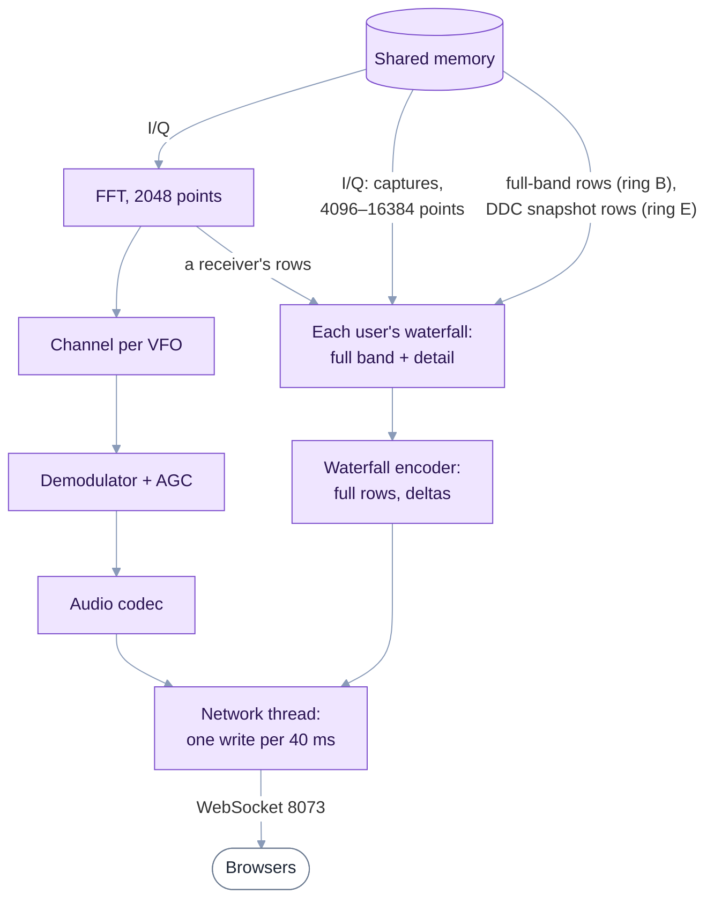

kweb owns no hardware. It reads I/Q and waterfall rows from shared memory and asks kbridge for DDCs through ring C.
A listener can use any of these sources:

- a **fixed band window** (one shared DDC, started on demand and stopped 30 s, `linger`, after the last listener
  leaves);
- the **free-tuning window**, moved by its owner;
- **their own receiver**, moved to wherever they tune that no window or host slice already covers (with
  `default_source = own` a new user starts on one, like a KiwiSDR channel);
- **a host slice that already covers the band**, which costs no extra DDC or link capacity. When a band can't get a
  DDC of its own, listeners are moved onto a host slice that covers at least 20 kHz of it.

One DSP thread processes all of them. It runs a 2048-point FFT with overlap-save. The source's waterfall rows come
from it (20 a second), and each VFO's channel is cut from it and brought down to 24 kS/s. That channel is demodulated
(AM, SAM, SSB, CW or FM), with AGC except for FM, and encoded as Opus (CELT), IMA ADPCM or 12 kS/s PCM. A CPU guard
predicts the cost of each new source, VFO or mode from a measured model and admits it only if it fits in the idle
time (averaged over about 10 s) minus `cpu_reserve` and what was admitted recently (see [Bottlenecks](#11-bottlenecks)). `cpu_reserve = 0` turns it off: everything is admitted, and an overloaded Beagle shows up as gaps in the audio instead of refusals. Each browser gets one
WebSocket carrying JSON status, waterfall rows (full rows and deltas) and the audio of each VFO. A network thread
writes everything queued for a browser in one write every 40 ms (two 20 ms audio frames): the kernel's TCP work is
paid per write and per packet, and going from 20 to 40 ms took kweb from 49.1 to 45.6 % of the CPU with ten
listeners. A reply to something the user just did (status, zoom, notes) goes at once instead (measured: 5–19 ms from
a command to its status). FT8/FT4/FT2/WSPR decoding runs in the browser (WebAssembly).

### Listen along and "On air"

A listener can hear another listener's VFO instead of having one of their own, like camping on a channel of a stock
KiwiSDR. kweb doesn't demodulate it a second time. Each 20 ms frame of the followed VFO is encoded once, and a copy
goes into each follower's queue as VFO id 200, with the same sequence number and GPS timestamp. Every frame can be
decoded on its own (an ADPCM frame carries its predictor, PCM has no state, Opus settles within a few ms), so a
follower can join at any time.

- **What it costs:** measured with 5, 10 and 20 listeners following one VFO on the 40 m window, kweb took about
  0.65 % of the core per follower, against 3.3 % per listener with their own VFO there. 21 listeners, 20 of them
  following, ran at 39 % busy; 21 with their own VFOs reached the CPU guard at 15 and 76 % busy
  (`bench/results/2026-11-28-along`). A follower needs no DDC and no link capacity.
- **The follower sees what the owner sees:** frequency, mode, passband, AGC, squelch, noise blanker and the signal
  meter from kweb's VFO state, and the owner's waterfall view (their zooms and pans, rows made at the follower's
  width). The owner's page also reports what only the browser knows (notch, noise reduction, the digital-mode
  decoder, the waterfall's levels) and kweb passes it on, so the follower's browser runs the same notch, noise
  reduction and decoder on its copy of the audio. A change on the owner's page shows on the follower's within about
  40 ms (measured: 8–40 ms). Volume, pan and mute stay the follower's own.
- **When it ends:** if the owner removes the VFO or leaves, the follower is told, and kweb offers them a VFO of their
  own when the CPU guard admits one. Starting to listen along releases the follower's own VFOs and source.
- **Admission:** listening along is admitted by the CPU guard like anything else, at the cost of a user with no
  VFO plus a small copy cost. When the guard refuses someone a VFO, the note suggests listening along instead.

The users pill in the page's top bar opens **On air**: every listener as "listener N" (a label per session, never an
address, name or browser), each VFO's frequency, mode, width and how many listen along, with "tune here" and
"listen along" buttons; the PC's stream (its kind, receivers, widths and links, never its address); and the board
(band windows, own receivers in use, the zoomed-detail receiver, free DDCs, CPU). kweb builds it only while someone
has the panel open, sends it at most once a second and only when it changed, and at once after someone starts or stops
listening along. `onair = on | owner | off` in `[kweb]` turns the panel and listening along on for everyone, for the
owner and admin only, or off; `along_max` limits the followers per VFO (0, the default: no limit).

### The waterfall on the page

With `zoom_waterfall = on`, as the example configuration ships, each user has one main waterfall that zooms from all
of 0–33.3 MHz down to 2 kHz across. With it off (or no line), each has two: the full band, and the narrow waterfall of
the window they listen to, 20 rows a second.

Zoomed in finer than 2 kHz per pixel, kweb picks what feeds the view, in this order, always over the full band's rows,
which fill in around and behind it:

| Feeds the view | When | Bins | Rows/s |
|---|---|---|---|
| a running receiver's own rows | it covers at least 90 % of the view (any part, finer than 100 Hz per pixel) | its FFT's, fs / 2048: 122 Hz on the 40 m window | 10 |
| captures (`zoom_capture`) | zoomed past 0.7 × those bins per pixel | FFTs of 4096 to 16384 of the receiver's newest samples: down to 15 Hz on 40 m | `zoom_fps` (10) |
| DDC snapshots (`zoom_snapshots`) | no running receiver covers all of the view, 4.1 kHz to 1.96 MHz across | 1024 over the view | up to `zoom_fps`, shared ([section 5](#the-zoomable-waterfall-ddc-snapshots)) |
| the full band alone | none of these: wider than 1.96 MHz, or no DDC of 9–12 free | 4.07 kHz | 10 |

A zoom viewer is not a listener: watching a band keeps no window running, and a receiver that stops or moves sends the
view on to the next best source. Captures are shared by every view on the same receiver and size, admitted by the CPU
guard and the first thing it sheds. (`zoom_windows` can also start streaming spare DDCs for zoomed views, the older
way; it is 0, off, by default, since the snapshots replace it.)

**The snapshots give way.** kweb asks kbridge for each view at `zoom_fps` while the CPU guard has room. Each second it
looks at the guard's headroom. Short of it, kweb lowers the rate by what is missing, from the measured cost per frame,
and counts the change at once rather than waiting for the ten-second idle average to show it. With room again it raises
the rate one step every 2 s, or straight back to `zoom_fps` with plenty. A listener who would not fit otherwise slows
every view to 2 frames/s at once. kbridge, for its part, gives the DDC to any listener or host slice that needs it.

**Each user can turn their waterfall off**, with the page's "waterfall" box. kweb then sends them no rows of any kind and
holds nothing for their view: no snapshot view, no capture, no zoom window. The page hides the spectrum and the
waterfall; tuning works from "go to kHz" and the VFO's frequency box. A browser tab that is hidden does the same. **A
user can also have the waterfall alone**, with the "audio" box (or the × on their last VFO): their VFOs go, and kweb
does not give them one back until they ask with "+ VFO" or the box. The browser remembers both choices and sends them
when the page connects (`/ws?nowf`, `/ws?noaudio`), so kweb never starts rows, or the default VFO, for that user.

What a user's waterfall costs, measured with ten users who each also listen to 40 m (USB, ADPCM audio), each process's
CPU over 40 s, two or three runs averaged:

| Each user's waterfall | kweb | kbridge | rows/s each | waterfall data each |
|---|---|---|---|---|
| off | 38.9 % | 12.0 % | 0 | 0 |
| the full band | 41.9 % | 11.8 % | 10 | 71 kbit/s |
| zoomed in inside their own receiver | 44.0 % | 12.0 % | 10.2 | 26 kbit/s |
| zoomed in elsewhere: DDC snapshots | 46.7 % | 34.1 % | 8.3 | 41 kbit/s |
| the classic layout: full band and narrow | 46.8 % | 13.1 % | 30.3 | 119 kbit/s |

So each user who turns their waterfall off saves about 0.3 % of the CPU on the full band, 0.5 % zoomed into their own
receiver, 0.8 % in the classic layout, and about 3 % zoomed in on DDC snapshots (0.5 % in kweb and 2.2 % in kbridge,
plus about 0.6 Mbit/s of SPI). Their connection saves 26 to 119 kbit/s; their audio is 107 kbit/s with ADPCM, and
status about 23. Ten users with the waterfall alone, zoomed in on snapshots and no audio, took kweb 17.7 % and
kbridge 33 %.

### Decoders and noise reduction run in the browser

The Beagle has one core, shared by everyone. A listener's computer has many cores, and only that listener uses it.
So anything that only one listener needs, and that can work on the audio they already receive, runs in their
browser. It costs the Beagle nothing, and it scales with the number of listeners instead of against it.

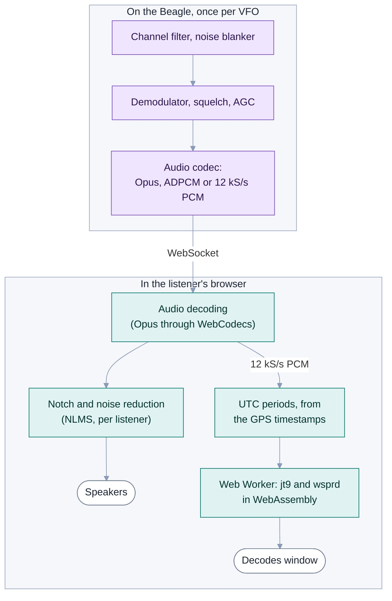

**Digital decoders: FT8, FT4, FT2 and WSPR.** These are VFO modes on the page. A decoding VFO receives USB as
12 kS/s PCM rather than a lossy codec, because lossy coding can cost the weakest decodes. The page cuts the audio
into UTC periods using the frames' GPS-based timestamps, smoothed over about a second, with sequence numbers to place
each frame. It decodes each period in a Web Worker, so decoding works even with the audio not playing.

The decoders come from [ubersdr_wsprd](https://github.com/madpsy/ubersdr_wsprd), a C++ rewrite of WSJT-X's `jt9`
and `wsprd` that gives the same decodes to the bit for a fraction of the CPU. Its README measures:

- **wsprd:** about a tenth of WSJT-X's CPU on x86-64 and a sixth on a Raspberry Pi 5, with AVX2 or NEON doing many
  lanes at once;
- **jt9:** under half for FT8.

Its WebAssembly builds, `jt9-wasm` (FT8, FT4, FT2 and MSK144) and `wsprd-wasm`, run the same decoders in any
browser. On its test recordings, 299 of 305 cases match WSJT-X's own output exactly. In the other six a few weak or
crowded-band decodes differ, because WebAssembly has no fused multiply-add and FFTW has no WebAssembly SIMD. `make
wasm` fetches the latest release (`make wasm-update` fetches it again), and kweb serves the modules from
`kweb-www/wasm/`. If periods start to queue up, the page skips one and says so, rather than falling ever further
behind.

**Noise reduction and the notch** run in the browser too: an NLMS predictor of 32 taps on the decoded audio, set by
each listener for their own VFO.

- **The notch** keeps the predictor's error, predicting 24 samples ahead. Steady tones are predictable, so they are
  removed.
- **Noise reduction** keeps the prediction itself, which is the part of the audio that is predictable: the signal.

These used to run on the Beagle. The code is still in `dsp.hpp`, but the page no longer switches it on, so a
listener's NR costs the Beagle nothing.

**What stays on the Beagle, and why.** Some things can only be done before the audio leaves:

- **The noise blanker** works on the channel's I/Q, before demodulation, removing impulses and the next two samples.
  Once the narrow filter and the AGC have spread an impulse into the audio, it can no longer be cut out cleanly, and
  the browser only ever sees the audio.
- **The AGC** sets the level before the audio is coded. Every codec, PCM included, is 16-bit or less, so the level
  has to be right before coding.
- **The squelch** decides from the channel's own measurements: level, SNR against the noise floor percentile around
  the VFO, or FM's noise. Those exist only where the channel does.

## 8. Ethernet

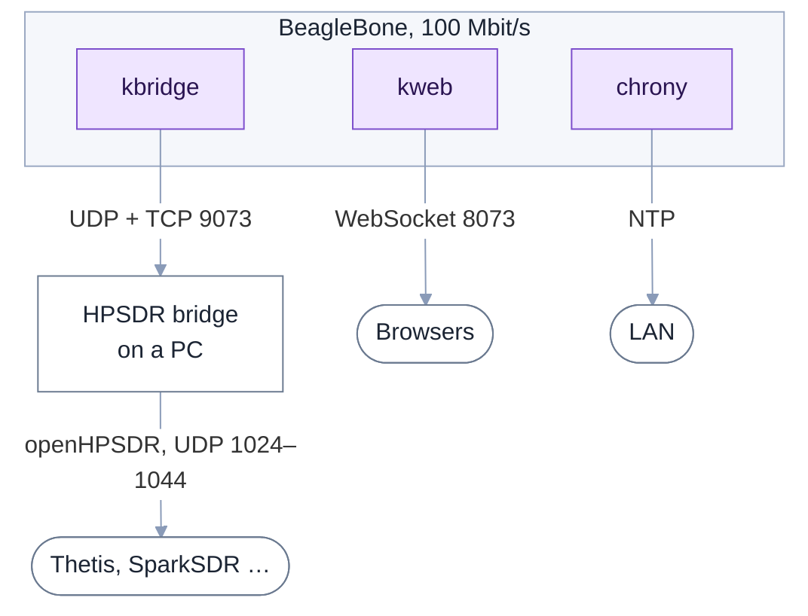

The heavy stream (up to about 80 Mbit/s, the two FPGA links combined) goes to one host client as UDP. Each datagram
fits one unfragmented 1500-byte packet and carries a sequence number and the offset of the first frame start in it,
so a lost datagram costs only the frames it touched. The samples go over the wire undecoded: SPI data as the FPGA's
packed groups, lanes data as the PRU's raw records. They are decoded on the PC, which also resamples them to each
HPSDR receiver's rate and frames them as 24-bit samples: up to 10 receivers with openHPSDR protocol 2, one with
protocol 1, on UDP ports 1024–1044 (protocol 2 sends DDC n's I/Q from port 1035 + n). Browsers get only audio, status and waterfall rows. Measured
per listener with ADPCM audio: 107 kbit/s of audio (96 kbit/s of samples plus framing; Opus is 32 kbit/s), 23 of
status, and 0 to 119 for the waterfall: none when they turn it off, 26 zoomed into their own receiver, 41 on DDC
snapshots, 71 on the full band, 119 in the classic two-waterfall layout. chrony serves GPS time by NTP.

## 9. The HPSDR bridge (on a PC)

`kiwi-hpsdr-bridge` (`host/hpsdr/`) makes the Kiwi look like an openHPSDR radio (Hermes or Hermes Lite 2) to Thetis,
SparkSDR, piHPSDR and other HPSDR software. It runs on a PC, not on the Beagle: resampling every receiver to the
client's exact rate would load the Beagle's one core, and HPSDR's 24-bit samples make the stream to the client
larger than the Kiwi's own. It is UberSDR's HPSDR bridge, itself built on Rick Koch's (N1GP) ka9q_hpsdr, with its
source swapped: the protocol side is unchanged and `ko_source.c` takes the stream from kbridge. Its own
[README](../host/hpsdr/README.md) has the details.

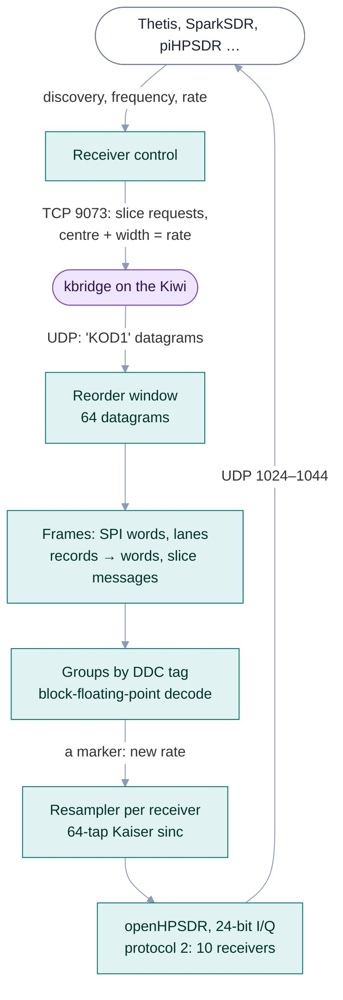

- **One slice per receiver.** Receiver k is kbridge's host slice k. When the client enables it, the bridge asks for a
  slice at the client's frequency with a usable width equal to the client's rate, so the whole HPSDR span lies in
  the slice's flat 80 % (48 kHz → R 511, 96 → R 277, 192 → R 138, 384 → R 69). A retune is the same slice with a new
  centre: kbridge resets the DDC, which leaves a gap of a few milliseconds, one marker, where a real Hermes would
  retune without one. A rate change resizes the slice; disabling the receiver deletes it. Ten receivers need
  `[pool] host_ddcs = 10`. A refused receiver is logged with kbridge's reason and asked for again every 5 s.
- **Getting the samples back.** The datagrams pass through a 64-datagram reorder window; a gap that stays is a loss,
  and the stream resyncs at the next frame start. SPI words come in `'KOW2'` frames. Lanes records (`'KOL2'`) are
  turned back into words here, on the PC, not on the Beagle. The words are split into groups by DDC tag and decoded
  from block floating point. A marker group starts the DDC's new configuration: the resampler restarts and the
  filters' 40-sample start-up transient is dropped.
- **Resampling.** Each receiver is resampled from its slice's rate to exactly the client's: a 64-tap Kaiser-windowed
  sinc at 256 phases, linearly interpolated, flat to ±0.45 of the output rate, with aliases only outside it. The
  sample clock is the Kiwi's own, GPS-measured.
- **Levels and orientation.** The DDC's full scale is put at the 24-bit field's full scale, as a Hermes puts its
  ADC's there, so a client's dBFS is the Kiwi's. HPSDR clients read each sample pair the other way round from the
  textbook I + jQ, so the bridge sends the imaginary part in the "I" field.
- **Protocols.** Both protocol 2 and protocol 1 ("Metis") are answered on UDP 1024; a client picks one by its
  discovery packet. Protocol 2 serves all ten receivers, sending DDC n's I/Q from port 1035 + n. Protocol 1 serves
  one. One client is served at a time. A client silent for 10 s (protocol 1: 3 s) is taken as gone and its slices
  are deleted, so a crashed client doesn't hold the Kiwi's DDCs. Rates are 48, 96, 192 and 384 kHz.
- **The bandscope** (protocol 2 wideband data) is the Kiwi's raw ADC snapshots, the same ones the full-band waterfall
  is computed from. kbridge forwards them to the host only while a client asks for them (about 2.6 Mbit/s).
- **Who it serves.** The bridge labels itself and each receiver (`'KOL1'` on the control connection), and kweb's
  admin page shows the client's address, its receivers and their events.
- **Not carried:** the Kiwi's GPS sample timestamps. HPSDR's I/Q packet has a timestamp field, but clients ignore it,
  so the bridge sends zeros.

Measured on 2026-11-26: 10 receivers at 192 kHz on 40 m for 60 s (protocol 2), 0 packets lost on all ten, each
delivering 191.9 kS/s, 58.9 Mbit/s from the Kiwi with no overflows or FPGA drops, and the bridge using 38 % of one
PC core.

## 10. NEON SIMD

The Beagle's Cortex-A8 has a slow scalar floating-point unit: its VFP is not pipelined, so each float operation
waits for the one before. Its NEON unit is pipelined and works on 128-bit vectors: four floats, eight int16 values
or four 32-bit words per instruction. On this core NEON is the difference between DSP that fits and DSP that
doesn't, so every hot loop that handles floats or bulk data uses it. Everything for the Beagle is built with
`-march=armv7-a -mtune=cortex-a8 -mfpu=neon -mfloat-abi=hard` (`Makefile`, `kweb/Makefile`,
`tools/build_opus.sh`). kweb's DSP and the waterfall code also have plain C versions (`#ifdef __ARM_NEON`), so the host-side tests
(`./build.sh test`) build and run on a PC; kbridge itself is built for the Beagle only.

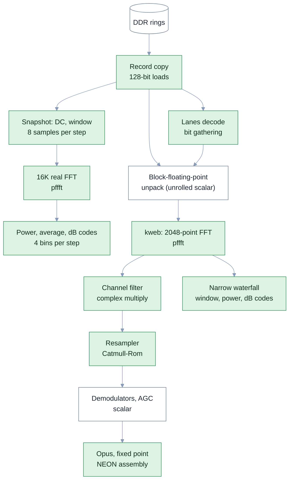

Green is NEON; white is scalar.

| Where | What NEON does | Why |
|---|---|---|
| kbridge, record copy (`pru_copy`) | 128-bit loads: four words per bus transaction instead of one | copying records out of the rings |
| kbridge, lanes decode (`klanes_dec.h`) | gathers every third bit of the PRU's packed words for each lane, four words at a time | about 25 ns per word against 58 for the scalar block decoder; gcc would not vectorise the loop because it cannot rule out aliasing |
| kbridge, waterfall (`kwf.c`) | int16 → float, DC removal and Blackman window, 8 samples per step; pffft's NEON FFT; power, the exponential average and the dB codes, 4 bins per step, with log2 from the float's exponent plus a polynomial | a 16 384-point FFT 10 times a second, plus 8192 bins of post-processing, on the one core |
| kweb, the DSP engine (`dsp.hpp`) | pffft's complex FFTs (2048-point forward, each VFO's inverse, the optional second filter stage); complex multiply-accumulate on de-interleaved re/im vectors (`vld2q`) for the filters and the per-block rotation; power sums; the Catmull-Rom resampler; int16 → float | each stage runs over a whole block in a tight loop, as 2- or 4-lane vectors, because the scalar VFP is not pipelined |
| kweb, narrow waterfall | the frequency-domain Hann window and power, 4 bins per step; the dB codes by the same fast log2 | 2048 `log10f` calls per row had cost about 1.5 % of the CPU on their own |
| Opus (`tools/build_opus.sh`) | the fixed-point libopus build with its ARMv7 NEON/EDSP assembly | measured 4.3 % of the core against 17–23 % for the float build; kweb's CELT-only mode costs 1.4–2.5 % per stream |

Where NEON is not used, and why:

- **The block-floating-point unpack** is scalar, but one fully unrolled loop body per mantissa size, so every shift
  is a constant. That is about 3 times faster than a running bit accumulator: 21 ns against 68 ns per sample at
  10 bits.
- **The SAM carrier PLL** is a complex rotator, with no `cos`, `sin` or `atan2` per sample, to keep work off the
  slow VFP.
- **The waterfall's DC sum** is done in integers, because the A8's integer ALU is far faster than its VFP.

Two A8 pitfalls shaped the code:

- **NEON loads from uncached memory hang the core**, with no oops and no log. That is why the DDR rings are mapped
  cached (see [The kernel module](hardware.md#3-the-kernel-module-kodma)). On the uncached fallback buffer, kbridge copies with
  plain 32-bit loads only.
- **Reading back data that NEON has just stored stalls the A8** on the first touch of each cache line. The lanes
  scanner therefore reads the cached ring directly rather than the copy that NEON has just written.

## 11. Bottlenecks

Everything in both parts of How it works is shaped by these limits. kbridge and kweb check them before taking on new work and refuse what
would exceed one, with the reason, so what is already running is not degraded. The one exception: a host slice that
the shared FIR cannot schedule is still set, with a warning, and any lateness shows up as counted drops.

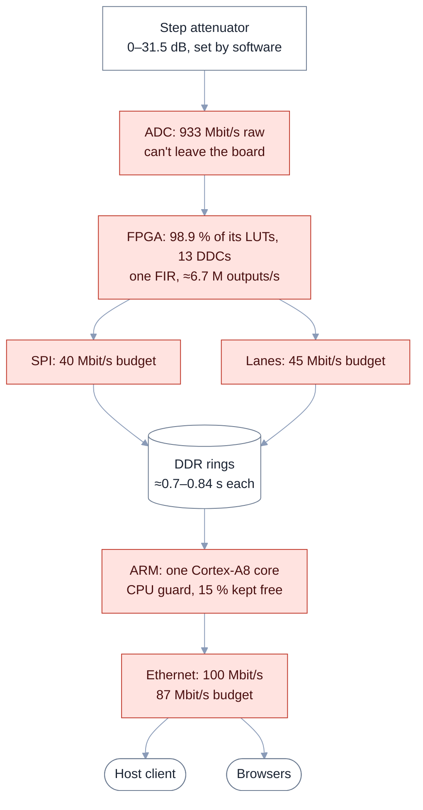

| Limit | Size | Enforced by | At the limit |
|---|---|---|---|
| ADC | 14 bit × 66.67 MS/s ≈ 933 Mbit/s | the design | nothing raw leaves the board except the 100 ms snapshots (≈2.8 Mbit/s) |
| FPGA logic | the stream gateware uses 98.9 % of the XC7A35T's LUTs as logic and 48 of 50 block-RAM tiles | the design | 13 DDCs is what fits; DDCs 0–3 alone take R > 256 |
| DDC snapshots | one DDC at a time (the highest free one of 9–12), a frame of about 1024 / span seconds; 100 frames/s on average for all views, 20 while the slices on SPI take more than 33 Mbit/s | kbridge's view scheduler (`ksnap.c`) and kweb's CPU guard (the frame rate per view) | views update less often; with no DDC of 9–12 free, zoomed views show the full band's rows |
| Shared FIR | about 10 clocks per output, lowest DDC first: ≈6.7 M outputs/s for all DDCs | `fir_sched_ok` (see [Flexible bandwidth](hardware.md#1-the-fpga)) | a web DDC is refused; a host slice is set with a warning and any lateness shows as counted drops |
| FPGA FIFOs | 4K words each, about 3 ms at full rate | the PRUs draining them without a break | whole groups are dropped and counted (header drop count); downstream sees a gap |
| SPI | 48 MHz clock; measured clean at 38.4 Mbit/s; allocator budget `spi_max` = 40 Mbit/s, snapshots included | `slice_request_one` | "link full: …", or the lanes if the route allows |
| PRU lanes | measured about 45 Mbit/s; budget `lane_max` = 45 Mbit/s | `slice_request_one` | as SPI |
| Both links | 87 Mbit/s in total (`TOT_MAX`, the Ethernet's usable payload) | `slice_request_one` | "over budget: …" |
| DDR rings | 4 MB each, ≈0.7–0.84 s of stream at full rate | the drain loop at `SCHED_FIFO 40` | if the ARM stalls longer, the full ring stops the PRU, the FPGA FIFO fills and whole groups are dropped (counted) |
| ARM CPU | one 1 GHz Cortex-A8 for Linux, kbridge and kweb | kweb's CPU guard: the ~10 s average idle time minus `cpu_reserve` (15 %) | a new source, VFO or mode is refused with a note: "the Beagle's CPU is busy: … needs ~x %, y % is free" (`cpu_reserve = 0`: never refused; the audio gets gaps instead) |
| Ethernet | 100 Mbit/s | the 87 Mbit/s budget above; browsers are small | — |

What uses the ARM, from the guard's cost model (`kweb/src/main.cpp`, % of the core). It was fitted to 271
measurements on the Beagle (`bench/costfit.mjs`, rms error 3.5 % of the core):

| Item | Cost |
|---|---|
| a web source (kweb's FFT and its waterfall rows, plus kbridge decoding its groups); also a host slice kweb listens to | 0.7 + 2.3 per 100 kS/s (+0.1 on the lanes) |
| a VFO, by mode, with ADPCM | 2.35 (AM) · 2.5 (IQ) · 3.05 (FM) · 3.2 (SSB) · 3.4 (CW) · 4.45 (SAM) · 4.8 (SAM stereo) |
| its codec, on top of that | ADPCM 0 · PCM 12k 0.5 · Opus 2.3 · Opus HQ 2.5 (stereo: 1.2, 3.6, 3.9) |
| a user (networking, waterfall rows, status) | 1.0 |
| a zoom capture, shared by its viewers | 0.43 (2048 points) · 0.85 (4096) · 3.0 (8192) · 7.2 (16384), at `zoom_fps` = 10 |
| a zoom window (`zoom_windows`) | 0.3 + 0.6 per 100 kS/s |
| the GPS satellite search | at most `gps_search_cpu` = 10 on average, only while a channel is free |

How the model compares with the Beagle (bench run `bench/results/2026-11-27-21-57-modes+waterfall+usecases`): on a
lightly loaded core it errs high. Four listeners on the 40 m window each cost 0.5 to 0.9 of what it says (USB with
ADPCM 2.9 % against 4.2 %, SAM with Opus 6.6 against 7.75). Each listener costs more as the core fills, and the
ramps match it closely: listeners added one at a time on 20 m took about 4.0 % each (the model: 4.2), own receivers
of 104 kHz 6.8 % each (6.9 with their VFO) and of 417 kHz 16.8 % (17.1). So the guard refuses a little early rather
than late.

DDC snapshots are not in the model: they are worth having only with CPU to spare, so the guard measures what they
take and sets their rate from what is left (see [The waterfall on the page](#the-waterfall-on-the-page)).

Host slices cost the ARM little: their groups are forwarded still packed, without decoding, in batches of datagrams
(`sendmmsg`). Measured (`bench/results/2026-11-28-lanecost`): one 192 kHz HPSDR receiver (5.9 Mbit/s) takes about 4 % of
the core, four about 18 %, on the lanes or on SPI alike. The lanes cost more ARM time per sample than SPI because the ARM turns the PRU's 3-bit samples back into
words.
